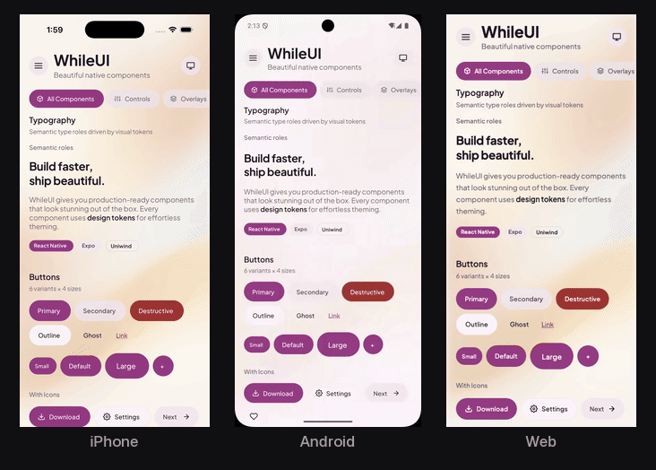
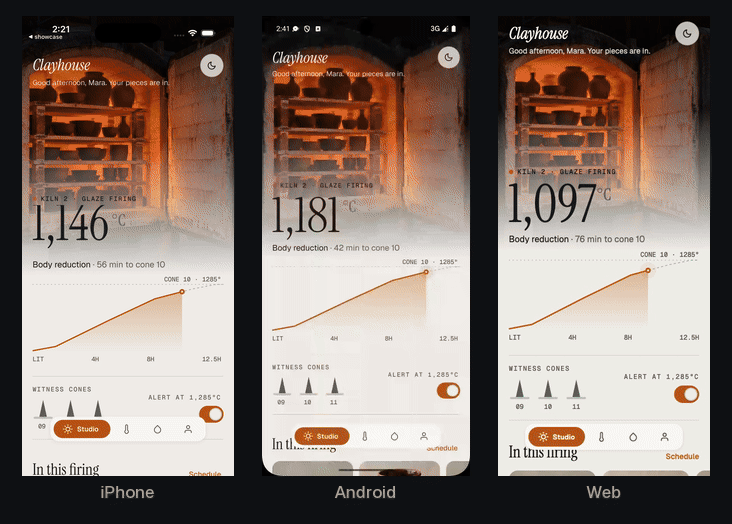

# WhileUI Native

> Accessible, themeable React Native components for iOS, Android and the web.

Components and blocks built with [Uniwind](https://uniwind.dev) + Tailwind CSS v4. Every
one takes `className` and exports its `tv()` variants for extension, and the look comes
from design tokens in your `global.css`, so a new theme needs no component changes. Auth
and profile screens are copy-paste templates in
[`apps/showcase/catalog/templates`](apps/showcase/catalog/templates) rather than package
exports: copy them and make them yours.

**Requirements:** React 19.3+, React Native 0.88+, Expo 58+ (if using Expo). See
[ROADMAP.md](./ROADMAP.md) for what the package owns and [PLAN.md](./PLAN.md) for the
supported stack.

## See it in action

The same app code on an iPhone simulator, an Android emulator and the web, running the
same tour side by side.

**The catalog** — every component and block, in light and dark
([`apps/showcase/catalog`](apps/showcase/catalog)):

<p align="center">
  
</p>

**Clayhouse** — a made-up ceramics studio app built only from WhileUI, with its own theme
and fonts ([`apps/showcase/clayhouse`](apps/showcase/clayhouse)):

<p align="center">
  
</p>

## Installation

```bash
bun add @thewhileloop/whileui
bun add react@^19.3.0 react-native@^0.88.0 uniwind@^1.12.2 tailwindcss@^4.0.0 react-native-reanimated react-native-safe-area-context react-native-screens
# Only if you use Select, Popover, Tooltip, or HoverCard:
bun add @rn-primitives/portal @rn-primitives/hooks @rn-primitives/slot @rn-primitives/select @rn-primitives/popover @rn-primitives/tooltip @rn-primitives/hover-card
# Only if you import @thewhileloop/whileui/markdown:
bun add markdown-it
```

Use `npm install` instead of `bun add` if you prefer npm.

### Setup Uniwind (required)

1. **metro.config.js** (wrap with `withWhileUIMetro`):

```js
const { getDefaultConfig } = require('expo/metro-config');
const { withWhileUIMetro } = require('@thewhileloop/whileui/metro');

/** @type {import('expo/metro-config').MetroConfig} */
const config = getDefaultConfig(__dirname);

module.exports = withWhileUIMetro(config, {
  cssEntryFile: './global.css',
});
```

> `withWhileUIMetro` calls Uniwind's `withUniwindConfig(config, options)` for you — same
> options, config first, `cssEntryFile` a relative path — and keeps `expo-asset`,
> `expo-font` and `@expo/vector-icons` on the real `react-native`. Without that, Uniwind's
> import rewrite leaves every icon glyph silently missing on iOS and Android while web
> renders fine. Pass `exemptFromUniwindRewrite: ['pkg']` for any other package that
> imports a `react-native` export Uniwind's wrapper lacks. It must be the outermost wrapper.

2. **global.css** at app root, imported from `App.tsx`:

```css
@import 'tailwindcss';
@import 'uniwind';

/* Required when installed from npm: Tailwind does not scan node_modules, so without
   this line every component renders unstyled. */
@source './node_modules/@thewhileloop/whileui/dist';

/* Then your theme: generate it (Theming, below) rather than writing tokens by hand. */
```

3. **App.tsx**:

```tsx
import './global.css';
import { MotionProvider, PortalHost } from '@thewhileloop/whileui';
import { Button, ButtonText } from '@thewhileloop/whileui';

export default function App() {
  return (
    <MotionProvider>
      {/* Your app content */}
      <PortalHost />
    </MotionProvider>
  );
}
```

`PortalHost` (last child of the root) is where Select, Popover, Tooltip and HoverCard
render. Inside a Dialog, Sheet, menu or picker they use that overlay's own layer
automatically, and Android back or Escape closes the innermost layer first. Pass
`portalHost` only to target a host you placed yourself, such as in a modal screen your
navigator presents.

### Vite + React Native Web + WhileUI setup

Use the WhileUI Vite compatibility helper when your app includes portal-based primitives.

1. Install Vite + RN web basics:

```bash
bun add react-dom react-native-web
bun add -d vite @vitejs/plugin-react
```

2. `vite.config.ts`:

```ts
import { defineConfig } from 'vite';
import react from '@vitejs/plugin-react';
import { withWhileUIViteCompat } from '@thewhileloop/whileui/vite';

export default defineConfig(withWhileUIViteCompat({ plugins: [react()] }));
```

3. Keep `PortalHost` at app root when using Select/Popover/Tooltip/HoverCard.

Troubleshooting:

| Symptom                                                  | Likely cause                                              | Fix                                                                                                 |
| -------------------------------------------------------- | --------------------------------------------------------- | --------------------------------------------------------------------------------------------------- |
| `Unexpected token <` from `@rn-primitives/*/dist/*.mjs`  | rn-primitives ships raw JSX in dist for some packages     | Use `withWhileUIViteCompat(...)` in `vite.config.ts`                                                |
| `className` rejected on RN primitives in consumer TS app | RN `className` augmentation not loaded from package entry | Import components from `@thewhileloop/whileui` (or side-effect import the package entry before use) |
| Theme token resolves differently on native/web           | Missing `--app-color-*` fallback for non-RN-native values | Add `--app-color-*` fallbacks in `global.css` for any `oklch(...)` token used by native APIs        |

## Usage

```tsx
import {
  Button,
  ButtonText,
  Card,
  CardHeader,
  CardTitle,
  CardContent,
  Input,
  Text,
} from '@thewhileloop/whileui';

function MyScreen() {
  return (
    <Card>
      <CardHeader>
        <CardTitle>Welcome</CardTitle>
      </CardHeader>
      <CardContent>
        <Input placeholder="Email" />
        <Button className="mt-4">
          <ButtonText>Continue</ButtonText>
        </Button>
      </CardContent>
    </Card>
  );
}
```

## AI agents

Every release ships its docs for agents inside the package, so an agent reads the docs for
the version you have installed, not whatever a website currently shows:

- `node_modules/@thewhileloop/whileui/dist/agent/llms.txt` — rules, composition grammar
  and every component in one page. `llms-components.txt` adds each API section;
  `llms-full.txt` is this README.
- [`@thewhileloop/whileui-mcp`](packages/mcp/README.md) serves the same catalog over MCP
  (`list_components`, `get_component_docs`, `get_theme_tokens`, `get_guide`):

  ```bash
  claude mcp add whileui -- npx -y @thewhileloop/whileui-mcp
  ```

- A [skill](skills/whileui/SKILL.md) for Claude Code, Cursor, Codex and other agents
  that load skills: setup traps, how to compose and theme, and how to check a screen. It
  points at the installed docs rather than copying them, and the build fails if it names
  an API, MCP tool or file that no longer exists. Install it with
  `npx skills add whileloophq/whileui`, or copy `skills/whileui` into your agent's skills
  folder (for Claude Code, `.claude/skills/`).

The docs and catalog are generated from this README at build time, and the build fails if
a component named here is not exported.

## Quick Reference (AI / Code Generation)

- **Full-screen:** `AppShell` + `Header` in `header` + `BottomNav` in `bottomNav` + content in `children`
- **Text fields:** a field never moves itself out from under the keyboard; its scroll
  view does. Any screen holding an `Input`, `Textarea`, `NumericInput`, `OTPInput` or
  `SearchField` scrolls in `KeyboardAwareScrollView`, never a plain `ScrollView`; a docked
  composer uses `KeyboardAwareScreen` + `DockedInput`.
- **No-jump loading:** keep `AppShell` mounted, set `loading` + `skeleton` (e.g., `PageSkeleton`/`ScreenSkeleton`)
- **Layout:** `Stack` (vertical), `Row` (horizontal) — both support `gap`, `align`, `justify`
- **Auth callbacks:** Auth templates use objects: `onSubmit({ email, password })`, `onSubmit({ firstName, lastName, email, password })`, etc. Copy templates from `apps/showcase/catalog/templates/auth/`.
- **PortalHost:** Add `<PortalHost />` at app root for Select, Popover, Tooltip, HoverCard.
  Inside any WhileUI overlay they render into that overlay's layer without configuration.
- **Motion:** Wrap the root in `<MotionProvider>`; use `useMotionPolicy()` for semantic
  durations, the responsive spring, and reduced-motion behavior.
- **Metro:** `withWhileUIMetro(config, { cssEntryFile: './global.css' })` from
  `@thewhileloop/whileui/metro` — wraps Uniwind and keeps icon fonts loading on device.
  `global.css` at app root, imported in `App.tsx`. Installing from npm also needs
  `@source './node_modules/@thewhileloop/whileui/dist';` or every component renders unstyled.
- **States:** `LoadingState`, `EmptyState` and `ErrorState` share one shape; `ErrorState`
  takes `onRetry`. `Text variant="eyebrow"` is the muted section label above a title.
- **Reference:** Block props in `packages/ui/src/blocks` (core) and `apps/showcase/catalog/templates/` (auth, profile); flow patterns in README "Flow Patterns" section.

### Composition grammar

- Start with one page canvas and flat sections. Add a `Surface` only when grouping or
  elevation communicates something; do not wrap every section in a card.
- Use `level="base"` for grouped content, `raised` for selectable or floating regions,
  and `overlay` for content above the page. Avoid nesting more than one surfaced level.
- Express hierarchy through `Text` variants before custom font-size classes. Keep one
  primary action per region and constrain long-form content with `Container`.
- Forms use `FormField`; its disabled and invalid state flows into `Input`, `Textarea`,
  `NumericInput`, and `Select`. Pass a control prop only to override that inherited state.
- Chat mechanics belong to `ChatConversation` + `SmartInput`. Message payloads, tools,
  reasoning, approvals, sources, and action rows are application-owned compositions.
- Import Markdown and code rendering from their optional subpaths. Do not make the root
  package pay for content rendering when the screen does not use it.

## Components

### Primitives

| Component     | Notes                                            |
| ------------- | ------------------------------------------------ |
| **Text**      | Themed text with variant support                 |
| **Surface**   | Token-backed base, raised, and overlay container |
| **View**      | Themed view wrapper                              |
| **Pressable** | Themed pressable wrapper                         |
| **Stack**     | Vertical flex layout with gap                    |
| **Row**       | Horizontal flex layout with gap                  |

### Root Providers

| Provider           | Notes                                                                    |
| ------------------ | ------------------------------------------------------------------------ |
| **MotionProvider** | System reduced motion, explicit preview modes, and deterministic testing |

### Form Controls

| Component            | Variants                                              | Notes                                                                                         |
| -------------------- | ----------------------------------------------------- | --------------------------------------------------------------------------------------------- |
| **Button**           | default, destructive, outline, secondary, ghost, link | 4 sizes, ButtonText & ButtonIcon sub-components                                               |
| **Input**            | default, error                                        | TextInput wrapper with themed styling                                                         |
| **NumericInput**     | default, error                                        | Numeric input with prefix/suffix slots, optional steppers, and compact size                   |
| **OTPInput**         | default, error; default, compact                      | Verification code input with auto-focus, paste, secure mask, loading skeleton, error shake    |
| **FormField**        | default, compact                                      | Compound API: FormField, FormLabel, FormControl, FormHint, FormMessage                        |
| **LabeledField**     | default, compact                                      | Field wrapper with label/helper/error plus left/right slots                                   |
| **Textarea**         | —                                                     | Multi-line text input                                                                         |
| **Checkbox**         | —                                                     | Controlled/uncontrolled; `label` and `description` make one labelled row                      |
| **Switch**           | —                                                     | Controlled/uncontrolled; `label` and `description` make one labelled row                      |
| **RadioGroup**       | —                                                     | RadioGroup + RadioGroupItem                                                                   |
| **Select**           | —                                                     | Uses `SelectOption` type `{value, label}`. Includes SelectGroup, SelectLabel, SelectSeparator |
| **SelectField**      | —                                                     | Labelled select from an `options` array; empty-string values allowed                          |
| **SearchField**      | —                                                     | Search input with a magnifier and clear button; pairs with `useDebouncedSearch`               |
| **Label**            | —                                                     | Form field label                                                                              |
| **SegmentedControl** | default, pill; single select                          | SegmentedControl, SegmentedControlItem, SegmentedControlItemText with wrapping layout support |
| **Toggle**           | default, outline                                      | ToggleText sub-component                                                                      |
| **ToggleGroup**      | single, multiple                                      | Group of toggle items                                                                         |

### Display

| Component       | Variants                                                | Notes                                                                           |
| --------------- | ------------------------------------------------------- | ------------------------------------------------------------------------------- |
| **Card**        | padding (none, sm, default, lg), unstyled               | Compound: Card, CardHeader, CardTitle, CardDescription, CardContent, CardFooter |
| **Surface**     | level (base, raised, overlay)                           | Shared radius, padding, border, shadow, and optional frosted treatment          |
| **Badge**       | default, secondary, destructive, outline, success       | BadgeText sub-component                                                         |
| **FAB**         | default, secondary, destructive, surface; sm/default/lg | Floating action button. `label` required; pass your own icon as children        |
| **Alert**       | default, destructive, success, warning                  | AlertTitle & AlertDescription                                                   |
| **Avatar**      | sm, default, lg                                         | AvatarImage + AvatarFallback                                                    |
| **DataRow**     | default, compact                                        | DataRow, DataRowLeft/Center/Right, DataRowLabel/Description/Value; `onPress`    |
| **Pagination**  | —                                                       | "83 total · Previous · Page 2 of 4 · Next" under a paged list                   |
| **Separator**   | horizontal, vertical                                    | Themed divider                                                                  |
| **Progress**    | sm, default, lg                                         | Value-based progress bar with accessibility                                     |
| **Spinner**     | sm, default, lg                                         | ActivityIndicator wrapper                                                       |
| **Skeleton**    | pulse, shimmer                                          | Loading placeholder (pulse = opacity fade, shimmer = sweep)                     |
| **AspectRatio** | —                                                       | Maintain aspect ratio container                                                 |

### Layout

| Component       | Notes                                    |
| --------------- | ---------------------------------------- |
| **Tabs**        | TabsList, TabsTrigger, TabsContent       |
| **Accordion**   | AccordionItem, AccordionTrigger, Content |
| **Collapsible** | CollapsibleTrigger, CollapsibleContent   |
| **Container**   | Centred content column with a max width  |

### Overlays & Menus

| Component        | Notes                                                |
| ---------------- | ---------------------------------------------------- |
| **Dialog**       | Modal dialog with Header, Footer, Title, Description |
| **AlertDialog**  | Confirmation dialog with Action/Cancel buttons       |
| **Popover**      | Position-aware popover (requires PortalHost)         |
| **Tooltip**      | Position-aware tooltip (requires PortalHost)         |
| **DropdownMenu** | DropdownMenuTrigger, Content, Item, Label, Separator |
| **ContextMenu**  | Long-press context menu                              |
| **HoverCard**    | Position-aware hover card (requires PortalHost)      |
| **Menubar**      | Horizontal menu bar                                  |

### Feedback

| Component | Notes                                          |
| --------- | ---------------------------------------------- |
| **Toast** | ToastProvider, ToastContainer, useToast() hook |

## Blocks (Pre-built Screens)

### Auth (Copy from showcase templates)

Copy from `apps/showcase/catalog/templates/auth/`:

| Block                  | File                       | Description                           |
| ---------------------- | -------------------------- | ------------------------------------- |
| **SignInForm**         | `sign-in-form.tsx`         | Email/password sign in with callbacks |
| **SignUpForm**         | `sign-up-form.tsx`         | Registration form with callbacks      |
| **ForgotPasswordForm** | `forgot-password-form.tsx` | Password reset request                |
| **ResetPasswordForm**  | `reset-password-form.tsx`  | Set new password                      |
| **VerifyEmailForm**    | `verify-email-form.tsx`    | Email verification code input         |
| **SocialConnections**  | `social-connections.tsx`   | OAuth provider buttons                |
| **UserMenu**           | `user-menu.tsx`            | Profile dropdown for auth flows       |

### Navigation

| Block                 | Description                                      |
| --------------------- | ------------------------------------------------ |
| **AppShell**          | Layout shell with header/footer/bottomNav slots  |
| **Header**            | Top app bar with back/actions                    |
| **PageHeader**        | A screen's heading: kicker, title, mark, actions |
| **BottomNav**         | Tab-style bottom navigation bar                  |
| **FloatingBottomNav** | Elevated bottom nav with safe area support       |
| **TabBar**            | Top tab bar with indicator                       |
| **DrawerMenu**        | Drawer with sections and items                   |

### Layout

| Block                       | Description                                                           |
| --------------------------- | --------------------------------------------------------------------- |
| **ActionBar**               | Sticky bottom action row with safe-area padding                       |
| **ConfirmActionSheet**      | Reusable destructive confirmation sheet                               |
| **Sheet**                   | Bottom sheet modal with header/content/footer slots                   |
| **FormModalScreen**         | Modal scaffold for forms with loading states                          |
| **ContentSkeleton**         | Page/content placeholder with variants (list, card, generic)          |
| **PageSkeleton**            | Variant-based page layouts (dashboard, list, settings, card, generic) |
| **ScreenSkeleton**          | Header slot/placeholder + PageSkeleton content in one block           |
| **ErrorBoundary**           | React ErrorBoundary that renders ErrorState by default                |
| **EmptyState**              | Empty content placeholder                                             |
| **ErrorState**              | Error display with retry                                              |
| **LoadingState**            | In-flow loading placeholder for a section still fetching              |
| **LoadingScreen**           | Full-screen loading indicator                                         |
| **PullToRefreshScrollView** | Themed ScrollView with RefreshControl (useThemeTokens for colors)     |
| **KeyboardAwareScreen**     | One screen-level keyboard policy for bottom-docked controls           |
| **KeyboardAwareScrollView** | Form scroll root that keeps the focused field above the keyboard      |
| **DockedInput**             | Safe-area-aware bottom dock that reports its complete height          |
| **SmartInput**              | Compose input with slots, variants, and optional rotating examples    |
| **SplashScreen**            | Branded splash (fade/scale/slide variants)                            |
| **MinimalSplash**           | Minimal monochrome splash                                             |
| **BrandedSplash**           | Splash with brand imagery                                             |

### Chat

| Block                 | Description                                                     |
| --------------------- | --------------------------------------------------------------- |
| **Chat**              | Opinionated messages, suggestions, and SmartInput composition   |
| **ChatConversation**  | Constrained conversation viewport that follows streaming output |
| **ChatMessageBubble** | Message bubble (user/assistant, big/small text)                 |
| **ChatSuggestions**   | Suggestion chips when empty                                     |

### Profile & Settings (Copy from showcase templates)

Copy from `apps/showcase/catalog/templates/profile/`:

| Block               | File                   | Description                         |
| ------------------- | ---------------------- | ----------------------------------- |
| **ProfileHeader**   | `profile-header.tsx`   | Profile header with stats           |
| **AccountCard**     | `account-card.tsx`     | Account summary card                |
| **SettingsSection** | `settings-section.tsx` | Section header with optional action |
| **SettingsItem**    | `settings-item.tsx`    | Row for toggles/links/settings      |

### Lists

| Block                | Description                         |
| -------------------- | ----------------------------------- |
| **ListItem**         | Title/subtitle row                  |
| **NotificationItem** | Notification row with metadata      |
| **TimelineFeed**     | Vertical feed with connecting lines |
| **SectionedList**    | Rows under a heading per section    |

### Commerce

| Block                | Description                                   |
| -------------------- | --------------------------------------------- |
| **ProductCard**      | Product card with badge/media                 |
| **PricingCard**      | Pricing tiers with feature list               |
| **CheckoutSummary**  | Cart summary with line items                  |
| **MetricCard**       | Stats/progress card for dashboards            |
| **SubscriptionCard** | Current plan card with manage/upgrade actions |
| **FeatureGate**      | Locked feature state with upgrade CTA         |
| **UsageBar**         | Quota meter with warning/exceeded states      |
| **PlanToggle**       | Monthly vs annual plan switcher               |
| **UpgradeBanner**    | Inline upgrade banner with action/dismiss     |

### Media

| Block          | Description                                                        |
| -------------- | ------------------------------------------------------------------ |
| **SmartImage** | Image with explicit loading, loaded, fallback, and error lifecycle |

### Date Picker

| Block                    | Description                                       |
| ------------------------ | ------------------------------------------------- |
| **DatePickerModal**      | Bottom sheet modal with calendar, compact trigger |
| **DatePickerInline**     | Inline calendar for forms or dashboards           |
| **DateRangePickerModal** | Range selection modal with period marking         |
| **TimePickerModal**      | Hour and minute wheels in the same bottom sheet   |

**Tokens without a renderer.** `@thewhileloop/whileui/tokens` exports the theme
and visual contracts, the presets, and `deriveThemeColors(base, scheme)` — give it
the 25 base colours an app defines and it returns all 52, using the same ratios
as the default presets. Safe in a build script (no React, RN or Uniwind
imports); `useThemeColors()` uses it too, so a missing `--color-primary-soft`
derives from the app's own primary instead of falling back to the default palette.

**Building a product preset.** Use `createThemePreset` rather than a `ThemePreset`
literal — it takes the 25 base colours per scheme and derives the rest:

```ts
import { createThemePreset, themePresetToCss } from '@thewhileloop/whileui/tokens';

const preset = createThemePreset({
  name: 'acme',
  description: 'Acme brand palette.',
  light: { background: '...', foreground: '...', primary: '...' /* 25 base keys */ },
  dark: { background: '...', foreground: '...', primary: '...' },
  visual: { radiusLg: 12 }, // optional, partial
});

writeFileSync('theme.generated.css', themePresetToCss(preset));
```

The generated `@theme` block also sets Tailwind's `--radius-sm/md/lg/xl` and a
`control` spacing size from the preset, so classes in your own markup match the
components: `rounded-md` is the preset's medium radius, and `h-control-sm`, `h-control`
and `h-control-lg` (or `min-h-*`) are its control heights. Without them `rounded-md` is
Tailwind's fixed 6px, whatever the preset says. To keep a different class scale, define
those variables after importing the generated file.

The literal form asks for all 52 colours per scheme, including every active variant,
soft variant, overlay, surface, interaction state and shadow. Those are exactly what
`deriveThemeColors` computes, so hand-writing them produces a second derivation that
drifts from the library's. Override a derived value by assigning to the result.

`WHILEUI_PRESET_SOFT` is the airy default. `WHILEUI_PRESET_ATELIER` is the stronger
product preset: tighter geometry, opaque surfaces, firmer borders, real shadows, and no
blur. Use it as the acceptance check that a screen still has enough visual weight when
the soft treatment is removed.

### FAB

One primary action, raised above the content. It owns no icon dependency — pass the
glyph as children and colour it from `useIconColors()`, because icon libraries need a
concrete colour rather than a class.

```tsx
import { FAB, useIconColors } from '@thewhileloop/whileui';
import { Feather } from '@expo/vector-icons';

const icons = useIconColors();

<FAB label="New group" onPress={create}>
  <Feather name="plus" size={24} color={icons.primaryForeground} />
</FAB>;
```

| Prop        | Type                                             | Default    | Notes                                   |
| ----------- | ------------------------------------------------ | ---------- | --------------------------------------- |
| `label`     | `string`                                         | —          | Required. The accessible name           |
| `variant`   | `default \| secondary \| destructive \| surface` | `default`  |                                         |
| `size`      | `sm \| default \| lg`                            | `default`  | 48 / 56 / 64 — all clear touch minimums |
| `placement` | `floating \| floating-left \| inline`            | `floating` | `inline` lets the caller position it    |
| `safeArea`  | `boolean`                                        | `false`    | Add the safe-area insets when floating  |

`FABGroup` stacks secondary actions above one, bottom-right. The group floats and lays out
the FABs inside it in a column, whatever their `placement`. Sizes start at 48dp, so a FAB
never needs `hitSlop`.

A floating FAB sits 24pt from the bottom and side of its positioned ancestor. Above a tab
bar that is right as it is. Over a full-screen view, pass `safeArea` (to the FAB, or to the
`FABGroup`) so it clears the home indicator and the screen's curved corner. Leave it off
above a tab bar: the tab bar already clears the inset, though the screen still reports it.

A floating FAB covers whatever scrolls under it, so a list behind one ends with room for
it: `contentContainerStyle={{ paddingBottom: fabClearance() }}`, passing the FAB's `size`
when it is not the default. For a `safeArea` FAB pass the bottom inset too:
`fabClearance('default', useSafeAreaInsets().bottom)`.

## Layout Primitives (Stack, Row)

Use `Stack` for vertical layouts, `Row` for horizontal layouts. Both support `gap`, `align`, and `justify` variants.

```tsx
import { Stack, Row } from '@thewhileloop/whileui';

<Stack gap="lg">
  <Text>Title</Text>
  <Row gap="md" justify="between">
    <Button>
      <ButtonText>Cancel</ButtonText>
    </Button>
    <Button>
      <ButtonText>Save</ButtonText>
    </Button>
  </Row>
</Stack>;
```

<!-- api:Row -->

| Prop      | Type                                                                | Default    | Description |
| --------- | ------------------------------------------------------------------- | ---------- | ----------- |
| className | `string`                                                            | —          |             |
| gap       | `'none' \| 'xs' \| 'sm' \| 'md' \| 'lg' \| 'xl' \| '2xl'`           | `'md'`     |             |
| align     | `'start' \| 'center' \| 'end' \| 'stretch' \| 'baseline'`           | `'center'` |             |
| justify   | `'start' \| 'center' \| 'end' \| 'between' \| 'around' \| 'evenly'` | `'start'`  |             |

Also accepts the props of `ViewProps`.
<!-- /api:Row -->

### Container

Caps content width and centres it. Phone-first layouts stretch to the viewport, which
is right at 390px and wrong at 1600px — line lengths become unreadable and related
controls drift apart.

```tsx
<Container size="lg">{children}</Container>
```

<!-- api:Container -->

| Prop      | Type                                     | Default | Description |
| --------- | ---------------------------------------- | ------- | ----------- |
| className | `string`                                 | —       |             |
| size      | `'sm' \| 'md' \| 'lg' \| 'xl' \| 'full'` | `'md'`  |             |
| fill      | `boolean`                                | `false` |             |

Also accepts the props of `ViewProps`.
<!-- /api:Container -->

No platform branch, and none is needed: every size is wider than any phone, so on iOS
and Android the cap never engages and it renders as a plain full-width `View`. The same
component is a no-op on native and the whole fix on desktop.

For a scroll view, put the column on the content container so the scrollbar stays at
the window edge:

```tsx
<ScrollView contentContainerClassName="w-full max-w-5xl self-center" />
```

## Full-Screen Composition

Standard pattern: `AppShell` with `header`, scrollable `children`, and `bottomNav`.

```tsx
import { AppShell, Header, BottomNav, ScrollView } from '@thewhileloop/whileui';

<AppShell
  header={<Header title="Home" rightActions={[...]} />}
  bottomNav={
    <BottomNav
      items={[...]}
      value="home"
      onValueChange={(key) => setTab(key)}
    />
  }
>
  <ScrollView className="flex-1 p-4">
    {/* Screen content */}
  </ScrollView>
</AppShell>
```

### Flow Patterns

| Flow       | Blocks                                                                             |
| ---------- | ---------------------------------------------------------------------------------- |
| Auth       | SignInForm → SignUpForm → ForgotPasswordForm → VerifyEmailForm → ResetPasswordForm |
| Forms      | FormField + Input/NumericInput/LabeledField + DatePickerModal + FormModalScreen    |
| Settings   | ProfileHeader + SettingsSection + SettingsItem (+ FormModalScreen for edits)       |
| E-commerce | ProductCard list → CheckoutSummary + ActionBar                                     |
| Chat       | Chat, or ChatConversation + SmartInput for custom message/tool/source compositions |
| App shell  | AppShell + Header + BottomNav + content                                            |
| Loading    | AppShell (`loading`) + PageSkeleton/ScreenSkeleton (keep header mounted)           |

### Component-Level Loading

Many blocks accept a `loading` prop that renders a skeleton placeholder matching the component's own shape. No separate skeleton component needed — the block knows its own layout.

```tsx
<ProductCard loading title="" price="" />
<ListItem loading title="" />
<NotificationItem loading title="" message="" time="" />
<MetricCard loading label="" value="" />
<SubscriptionCard loading planName="" price="" />
<PricingCard loading name="" price="" features={[]} />
```

Blocks with `loading` support: ProductCard, ListItem, NotificationItem, MetricCard, SubscriptionCard, PricingCard, AppShell, Chat, FormModalScreen, CheckoutSummary.

Block props: see TypeScript interfaces in `packages/ui/src/blocks`.

## Theming

A theme is a set of CSS variables in `global.css`, in OKLCH, with a `light` and a `dark`
variant. Every component reads the same contract, so a theme must define **every** token
in both modes: a missing one silently falls back to an unstyled value at runtime.

### Generate a theme

`themeFromSeeds` builds a complete light and dark theme from three colours, and
`themePresetToCss` writes every token, including the hex fallbacks React Native APIs need,
ready to paste into `global.css`:

```ts
import { checkThemeContrast, themeFromSeeds, themePresetToCss } from '@thewhileloop/whileui/tokens';

const theme = themeFromSeeds({
  name: 'studio',
  description: 'Bone paper and burnt amber',
  light: { background: '#f0ede9', foreground: '#13161c', primary: '#b65400' },
  // optional: `dark` seeds (otherwise a dark page with the brand lifted to read on it),
  // `overrides` for any base colour, `visual` for radius and density tokens
});

checkThemeContrast(theme.light).filter((c) => !c.pass);
// [{ pair: 'primary on background', ratio: 4.23, min: 4.5, pass: false }, …]
const css = themePresetToCss(theme); // paste into global.css
```

Seeds are kept as given; the colours it derives (muted text, text on each fill, status
colours) are tuned to WCAG AA. `checkThemeContrast` checks any palette, hand-written ones
included: every text pairing at 4.5:1 and the focus ring at 3:1. A failing seed is
reported, never changed, because a brand colour is a brand decision. The built-in presets,
`WHILEUI_PRESET_SOFT` and `WHILEUI_PRESET_ATELIER`, go through `themePresetToCss` the same
way.

Switch at runtime with `Uniwind.setTheme('dark')` (or `'light'`, `'system'`), or let
`useThemeBridge` hold the choice. It returns the chosen `mode`, the `resolvedTheme` on
screen, `setMode`, `toggleTheme` and `cycleMode`. A sun/moon button calls `toggleTheme`,
which always flips what is on screen; `cycleMode` steps light → dark → system and suits
a control that shows all three, because a step into `system` that resolves to the
current theme looks like a dead tap. Pass an `adapter` to keep the choice across launches:

```tsx
const { resolvedTheme, toggleTheme } = useThemeBridge({
  adapter: {
    loadThemeMode: () => storage.getItem('theme') as ThemeMode | null,
    saveThemeMode: (mode) => storage.setItem('theme', mode),
  },
});
```

A named extra theme is registered with `extraThemes: ['name']` in `metro.config.js` and
defined with `@variant name`. The full token list, with each default, is in `theme-contract.ts`,
and agents can read it from the MCP server's `get_theme_tokens`.

### Frosted surfaces

Cards and overlays take `frosted`, `blurIntensity` and `blurTintToken`
(`'surfaceElevated' | 'surfaceTranslucent' | 'card' | 'popover'`). Without a blur view
they tint only; register `expo-blur` once for real blur:

```tsx
import { BlurView } from 'expo-blur';
import { registerFrostedBlurView } from '@thewhileloop/whileui';

registerFrostedBlurView(BlurView);
```

For a frosted look across a whole theme, make `surface-elevated`, `surface-border` and
`surface-highlight` translucent, in your light and dark variants or in a separate theme.
The tuning tokens:

| Token                                                                     | Default      | Effect                                                         |
| ------------------------------------------------------------------------- | ------------ | -------------------------------------------------------------- |
| `--ui-blur-intensity-subtle` / `-medium` / `-strong`                      | 18 / 26 / 34 | The three blur presets                                         |
| `--ui-frosted-android-tint-alpha-scale`                                   | 1.18         | Android needs denser tint; `1` matches iOS and web             |
| `--ui-frosted-android-experimental-blur`                                  | 1            | Uses `expo-blur`'s experimental Android blur; `0` turns it off |
| `--ui-frosted-highlight-height`                                           | 2            | Top sheen in px; `0` removes it                                |
| `--ui-blur-saturation-pct`                                                | 145          | Web saturation multiplier                                      |
| `--ui-frosted-backdrop-blur-intensity`, `-scale`                          | 22, 0.72     | Backdrop blur, and its ratio when a component overrides blur   |
| `--ui-drawer-frosted-inset`, `-radius`, `--ui-drawer-content-top-padding` | 10, 34, 0    | Frosted drawer shell                                           |

### Colours for React Native APIs

Icons, `ActivityIndicator` and other native APIs need hex or rgb, not OKLCH.
`useThemeColors()` returns the whole palette as React Native colours, falling back to the
`--app-color-*` tokens a generated theme includes; `useIconColors()` is the subset icons
use, with `muted` mapped to `mutedForeground`.

```tsx
const icons = useIconColors();
<Feather name="heart" size={20} color={icons.muted} />;
```

Input, Textarea, NumericInput, SmartInput, Spinner and LoadingScreen pick theme colours
when you omit `placeholderTextColor` or `spinnerColor`.

### Interaction and motion

Press opacity, disabled opacity, motion durations, the responsive spring, and the drawer
open and close durations are package constants on `INTERACTION_TOKENS`. They are not CSS
variables, so a theme does not change them.

Build a custom control on `Pressable`, whose `feedback` and `disabledFeedback` apply
those opacities. To read the values yourself, use `useInteractionTokens()`.

Wrap the application in `MotionProvider` to coordinate system reduced motion, an explicit
preview mode, and deterministic animation-free tests. The provider is optional. Without
it `useMotionPolicy` reports the durations and spring from `INTERACTION_TOKENS`, and
Reanimated follows the system setting. `reduced` preserves non-spatial feedback while asking Reanimated to skip motion;
`disabled` also resolves semantic durations to zero.

```tsx
import { MotionProvider, useMotionPolicy } from '@thewhileloop/whileui';

<MotionProvider mode="system">{/* application */}</MotionProvider>;

const motion = useMotionPolicy();
motion.durations.normal;
motion.springs.responsive;
```

## Focus rings

Every interactive component draws a themed focus ring on web. It uses `:focus-visible`,
so it appears for keyboard users and not after a mouse click, and it is driven by the
`--color-ring` token — restyle it with your theme, not with component overrides.

Your own controls get the same ring by rendering through WhileUI's `Pressable`, which
adds it whenever the control has a press handler (`focusIndicator="inset"` inside a
track). The classes below stay exported for the rare control that cannot be a
`Pressable`, such as one built on a third-party primitive.

| Export           | Use for                                                                         |
| ---------------- | ------------------------------------------------------------------------------- |
| `focusRing`      | Standalone controls — buttons, inputs, cards, nav items                         |
| `focusRingInset` | Controls flush inside a track, where an offset ring would clip (segments, tabs) |

Keyboard behaviour follows the WAI-ARIA patterns. A radio group, `SegmentedControl`,
single-choice `ToggleGroup` and tab list are one Tab stop with the arrow keys moving
inside; Space toggles a checkbox, switch or toggle and selects a radio or tab; Enter
presses a button. A `Pressable` with the `checkbox`, `switch`, `radio` or `tab` role
answers Space by itself.

**Do not use a bare `outline-none`.** It removes the browser's indicator and leaves
keyboard users with nothing, which fails WCAG 2.4.7. `focusRing` removes the default and
supplies a themed replacement in the same class. The one exemption is a visually hidden
input, where a visible proxy shows the focus instead — `OTPInput` does this with its
blinking cursor.

# API Reference

## Pressable

```tsx
import { Pressable, Text } from '@thewhileloop/whileui';

<Pressable feedback="strong" onPress={() => {}}>
  <Text>Open</Text>
</Pressable>;
```

The base every WhileUI control renders through; build custom controls on it rather than
React Native's `Pressable`. It decides from its handlers whether it is a control. With
`onPress`, `onLongPress`, `onPressIn` or `onPressOut` it is a `button` unless you pass
another role, a Tab stop on web with a focus ring, and at least 24px there, where
`hitSlop` does nothing. Without a handler it is plain content: no role, no feedback and
no Tab stop. Express state with `aria-checked`, `aria-selected` or `aria-expanded`; React
Native maps them to native accessibility state and React Native Web emits them as
written.

It preserves React Native's event, ref, accessibility and function-style `style`
contracts. Feedback changes opacity without changing layout. Native press state comes
directly from React Native; web adds a motion-policy-aware opacity transition.

<!-- api:Pressable -->

| Prop             | Type              | Default     | Description                                                                  |
| ---------------- | ----------------- | ----------- | ---------------------------------------------------------------------------- |
| className        | `string`          | —           | Additional Tailwind classes.                                                 |
| feedback         | `PressedVariant`  | `'none'`    | Semantic press feedback. `none` preserves a plain React Native Pressable.    |
| disabledFeedback | `DisabledVariant` | `'default'` | Opacity used while the control is unavailable.                               |
| loading          | `boolean`         | `false`     | Loading controls are busy and non-interactive, just like disabled controls.  |
| focusIndicator   | `FocusIndicator`  | `'ring'`    | Keyboard focus on web: `inset` inside a track, `none` when a proxy draws it. |

Also accepts the props of React Native's `PressableProps`.
<!-- /api:Pressable -->

## Button

```tsx
import { Button, ButtonText, ButtonIcon } from '@thewhileloop/whileui';

<Button variant="default" size="default" disabled={false} loading={false} onPress={() => {}}>
  <ButtonIcon>
    <Icon />
  </ButtonIcon>
  <ButtonText>Click me</ButtonText>
  {/* Placement is child order — a trailing ButtonIcon renders after the label. */}
  <ButtonIcon>
    <Icon />
  </ButtonIcon>
</Button>;
```

<!-- api:Button -->

| Prop             | Type                                                                          | Default     | Description                                                                  |
| ---------------- | ----------------------------------------------------------------------------- | ----------- | ---------------------------------------------------------------------------- |
| children         | `React.ReactNode`                                                             | —           |                                                                              |
| className        | `string`                                                                      | —           | Additional Tailwind classes.                                                 |
| disabled         | `boolean`                                                                     | `false`     | Disable the button.                                                          |
| loading          | `boolean`                                                                     | `false`     | Shows a centered spinner, exposes busy state, and prevents interaction.      |
| disabledFeedback | `DisabledVariant`                                                             | —           | Opacity used while the control is unavailable.                               |
| focusIndicator   | `FocusIndicator`                                                              | `'ring'`    | Keyboard focus on web: `inset` inside a track, `none` when a proxy draws it. |
| size             | `'sm' \| 'lg' \| 'default' \| 'icon'`                                         | `'default'` |                                                                              |
| variant          | `'default' \| 'destructive' \| 'outline' \| 'secondary' \| 'ghost' \| 'link'` | `'default'` |                                                                              |

Also accepts the props of `PressableProps`.
<!-- /api:Button -->

## Text

`Text` maps semantic roles to the active visual typography tokens; custom font-size
classes are unnecessary for normal hierarchy. `heading` also sets
`accessibilityRole="header"` unless the caller supplies another role.

`display` is the largest size, for an amount, a total or a metric that leads its screen
(`<Text variant="display">{formatMoney(total)}</Text>`). It reads the
`--ui-font-size-display` token (36 by default), so a preset can change it. It is not a
heading; give it a role yourself if it titles the screen.

<!-- api:Text -->

| Prop      | Type                                                                                                                    | Default     | Description |
| --------- | ----------------------------------------------------------------------------------------------------------------------- | ----------- | ----------- |
| className | `string`                                                                                                                | —           |             |
| size      | `'base' \| 'xs' \| 'sm' \| 'lg' \| 'xl' \| '2xl' \| '3xl'`                                                              | —           |             |
| variant   | `'default' \| 'heading' \| 'display' \| 'title' \| 'subtitle' \| 'body' \| 'caption' \| 'label' \| 'eyebrow' \| 'code'` | `'default'` |             |

Also accepts the props of React Native's `TextProps`.
<!-- /api:Text -->

## Input

```tsx
import { Input, useIconColors } from '@thewhileloop/whileui';
import { Feather } from '@expo/vector-icons';

const icons = useIconColors();

<Input placeholder="Email" variant="default" value={value} onChangeText={setValue} />;

<Input
  placeholder="Search"
  prefix={<Feather name="search" size={16} color={icons.muted} aria-hidden />}
/>;
```

On iOS and Android, Input, Textarea, NumericInput and SmartInput draw the caret and
selection in the theme's primary colour; pass `selectionColor` (and `cursorColor` on
Android) to override it. On web, filled surfaces keep their themed background,
foreground and caret when the browser autofills them.

<!-- api:Input -->

| Prop           | Type                              | Default     | Description                                                                                                                                          |
| -------------- | --------------------------------- | ----------- | ---------------------------------------------------------------------------------------------------------------------------------------------------- |
| aria-invalid   | `boolean`                         | —           |                                                                                                                                                      |
| className      | `string`                          | —           |                                                                                                                                                      |
| prefix         | `React.ReactNode`                 | —           | Shown before the text. A decorative icon here needs `aria-hidden`; screen readers otherwise stop on it as a separate element and read out its glyph. |
| suffix         | `React.ReactNode`                 | —           | Shown after the text: a unit, or a control such as a clear button.                                                                                   |
| inputClassName | `string`                          | —           |                                                                                                                                                      |
| variant        | `'default' \| 'error' \| 'plain'` | `'default'` |                                                                                                                                                      |

Also accepts the props of `TextInputProps`.
<!-- /api:Input -->

## NumericInput

```tsx
import { NumericInput } from '@thewhileloop/whileui';

<NumericInput
  value={amount}
  onValueChange={setAmount}
  prefix={<Text className="text-muted-foreground">$</Text>}
  suffix={<Text className="text-muted-foreground">USD</Text>}
  min={0}
  step={0.5}
  showSteppers
  size="compact"
/>;
```

<!-- api:NumericInput -->

| Prop           | Type                              | Default     | Description                                                                                                            |
| -------------- | --------------------------------- | ----------- | ---------------------------------------------------------------------------------------------------------------------- |
| aria-invalid   | `boolean`                         | —           |                                                                                                                        |
| className      | `string`                          | —           |                                                                                                                        |
| inputClassName | `string`                          | —           |                                                                                                                        |
| prefix         | `React.ReactNode`                 | —           |                                                                                                                        |
| suffix         | `React.ReactNode`                 | —           |                                                                                                                        |
| value          | `number \| null`                  | —           | Controlled numeric value.                                                                                              |
| defaultValue   | `number`                          | —           |                                                                                                                        |
| onValueChange  | `(value: number \| null) => void` | —           | Numeric value change callback.                                                                                         |
| min            | `number`                          | —           |                                                                                                                        |
| max            | `number`                          | —           |                                                                                                                        |
| step           | `number`                          | `1`         |                                                                                                                        |
| showSteppers   | `boolean`                         | `false`     | Show decrement/increment controls.                                                                                     |
| unstyled       | `boolean`                         | `false`     | Drop the field shell (border, background, radius, padding) for embedding inside another field shell like LabeledField. |
| size           | `'default' \| 'compact'`          | `'default'` |                                                                                                                        |
| variant        | `'default' \| 'error'`            | `'default'` |                                                                                                                        |

Also accepts the props of `TextInputProps`.
<!-- /api:NumericInput -->

## OTPInput

```tsx
import { OTPInput } from '@thewhileloop/whileui';

<OTPInput
  value={otp}
  onValueChange={setOtp}
  onComplete={(code) => verify(code)}
  length={6}
  variant="default"
/>;
```

<!-- api:OTPInput -->

| Prop          | Type                      | Default     | Description                        |
| ------------- | ------------------------- | ----------- | ---------------------------------- |
| length        | `number`                  | `6`         | Number of digit cells.             |
| value         | `string`                  | —           | Controlled value.                  |
| onValueChange | `(value: string) => void` | —           | Called on each digit change.       |
| onComplete    | `(code: string) => void`  | —           | Called when all digits are filled. |
| variant       | `'default' \| 'error'`    | `'default'` | Error variant triggers shake.      |
| size          | `'default' \| 'compact'`  | `'default'` | Cell size.                         |
| secure        | `boolean`                 | `false`     | Mask digits with dots.             |
| disabled      | `boolean`                 | `false`     |                                    |
| autoFocus     | `boolean`                 | `false`     | Focus first cell on mount.         |
| className     | `string`                  | —           |                                    |

Also accepts the props of `ViewProps`.
<!-- /api:OTPInput -->

## FormField

```tsx
import {
  FormField,
  FormLabel,
  FormControl,
  FormHint,
  FormMessage,
  Input,
} from '@thewhileloop/whileui';

<FormField required invalid={Boolean(error)}>
  <FormLabel>Email</FormLabel>
  <FormControl>
    <Input placeholder="you@example.com" />
  </FormControl>
  {error ? <FormMessage>{error}</FormMessage> : <FormHint>We'll never share your email.</FormHint>}
</FormField>;
```

`invalid` and `disabled` are inherited by `Input`, `Textarea`, `NumericInput`, and
`Select`. An explicit control prop wins. `useFormFieldState()` exposes the same state for
custom controls; labels, hints, messages, density, and required indicators remain part
of the compound field rather than each input.

`FormLabel` names the `Input`, `Textarea` or `NumericInput` beside it for assistive
technology (`aria-labelledby` on web and Android; `useFormFieldState().labelId` gives a
custom control the same id). A label passed to the control itself wins.

## Surface

```tsx
import { Surface } from '@thewhileloop/whileui';

<Surface level="raised" padding="default">
  {/* grouped content */}
</Surface>;
```

<!-- api:Surface -->

| Prop          | Type                           | Default             | Description                          |
| ------------- | ------------------------------ | ------------------- | ------------------------------------ |
| level         | `SurfaceLevel`                 | `'base'`            | Semantic background and depth tier.  |
| padding       | `SurfacePaddingSize`           | `'default'`         | Token-backed interior spacing.       |
| radius        | `'sm' \| 'md' \| 'lg' \| 'xl'` | `'xl'`              | Token-backed corner radius.          |
| bordered      | `boolean`                      | `true`              | Draw the theme hairline border.      |
| shadow        | `ShadowTier`                   | —                   | Override the level's depth.          |
| className     | `string`                       | —                   |                                      |
| frosted       | `boolean`                      | `false`             | Enable the optional frosted overlay. |
| blurIntensity | `number`                       | subtle preset       | Override blur amount directly.       |
| blurTintToken | `FrostedTintToken`             | `LEVEL_TINT[level]` | Tint token used for frosted mode.    |

Also accepts the props of `ViewProps`.
<!-- /api:Surface -->

## LabeledField

```tsx
import { LabeledField, LabeledFieldControl, Input } from '@thewhileloop/whileui';

<LabeledField
  label="Username"
  hint="3-20 characters"
  leftSlot={<Icon />}
  rightSlot={
    <Button size="sm">
      <ButtonText>Check</ButtonText>
    </Button>
  }
>
  <LabeledFieldControl>
    <Input className="border-0 bg-transparent px-0" />
  </LabeledFieldControl>
</LabeledField>;
```

## SegmentedControl

```tsx
import {
  SegmentedControl,
  SegmentedControlItem,
  SegmentedControlItemText,
} from '@thewhileloop/whileui';

<SegmentedControl value={unit} onValueChange={setUnit} variant="pill" wrap>
  <SegmentedControlItem value="metric">
    <SegmentedControlItemText>Metric</SegmentedControlItemText>
  </SegmentedControlItem>
  <SegmentedControlItem value="imperial">
    <SegmentedControlItemText>Imperial</SegmentedControlItemText>
  </SegmentedControlItem>
</SegmentedControl>;
```

When the labels do not fit a phone, `wrap="scroll"` keeps them on one row at full width
and scrolls sideways, instead of wrapping or truncating them.

<!-- api:SegmentedControl -->

| Prop          | Type                            | Default     | Description                                                                                                                                                                                                                                                                |
| ------------- | ------------------------------- | ----------- | -------------------------------------------------------------------------------------------------------------------------------------------------------------------------------------------------------------------------------------------------------------------------- |
| value         | `string`                        | —           |                                                                                                                                                                                                                                                                            |
| defaultValue  | `string`                        | `''`        |                                                                                                                                                                                                                                                                            |
| onValueChange | `(value: string) => void`       | —           |                                                                                                                                                                                                                                                                            |
| variant       | `'default' \| 'pill'`           | `'default'` | Pill = rounded-full items.                                                                                                                                                                                                                                                 |
| wrap          | `boolean \| 'auto' \| 'scroll'` | `'auto'`    | `true` wraps segments onto more rows; `false` keeps one row and shares its width. `'scroll'` keeps one row with each segment as wide as its label and scrolls sideways when they do not fit — for labels a phone cannot show in full. `'auto'` wraps above three segments. |
| size          | `'default' \| 'compact'`        | `'default'` |                                                                                                                                                                                                                                                                            |
| disabled      | `boolean`                       | `false`     |                                                                                                                                                                                                                                                                            |
| className     | `string`                        | —           |                                                                                                                                                                                                                                                                            |

Also accepts the props of `ViewProps`.
<!-- /api:SegmentedControl -->

## DataRow

```tsx
import {
  DataRow,
  DataRowLeft,
  DataRowCenter,
  DataRowRight,
  DataRowLabel,
  DataRowDescription,
  DataRowValue,
  Avatar,
  AvatarFallback,
} from '@thewhileloop/whileui';

<DataRow>
  <DataRowLeft>
    <Avatar size="sm">
      <AvatarFallback>JD</AvatarFallback>
    </Avatar>
  </DataRowLeft>
  <DataRowCenter>
    <DataRowLabel>Jane Doe</DataRowLabel>
    <DataRowDescription>Product Designer</DataRowDescription>
  </DataRowCenter>
  <DataRowRight>
    <DataRowValue>Owner</DataRowValue>
  </DataRowRight>
</DataRow>;
```

Give a row `onPress` and the whole row becomes one button: it gets the button role, the
shared pressed background and a focus ring, and a screen reader reads its content as the
button's name. Without `onPress` it stays plain content, so a row that does nothing
never looks disabled. Do not wrap a row in your own `Pressable`.

```tsx
<DataRow onPress={() => router.push(`/members/${member.id}`)}>…</DataRow>
```

<!-- api:DataRow -->

| Prop        | Type                                     | Default     | Description                                                                                                                                                            |
| ----------- | ---------------------------------------- | ----------- | ---------------------------------------------------------------------------------------------------------------------------------------------------------------------- |
| size        | `'default' \| 'compact'`                 | `'default'` | `compact` tightens the height and text for dense lists.                                                                                                                |
| className   | `string`                                 | —           |                                                                                                                                                                        |
| onPress     | `(event: GestureResponderEvent) => void` | —           | Make the whole row one button: role, pressed background and focus ring included. Without it the row is plain content, so a row that does nothing never looks disabled. |
| onLongPress | `(event: GestureResponderEvent) => void` | —           | Long-press handler; only used together with `onPress`.                                                                                                                 |
| disabled    | `boolean`                                | —           | Keep the row a button but stop it firing, dimmed and announced as disabled — for a row whose action is busy. Only used together with `onPress`.                        |

Also accepts the props of `ViewProps`.
<!-- /api:DataRow -->

## Card

```tsx
import {
  Card,
  CardHeader,
  CardTitle,
  CardDescription,
  CardContent,
  CardFooter,
} from '@thewhileloop/whileui';

<Card padding="default">
  <CardHeader>
    <CardTitle>Title</CardTitle>
    <CardDescription>Description</CardDescription>
  </CardHeader>
  <CardContent>{/* Content */}</CardContent>
  <CardFooter>{/* Footer */}</CardFooter>
</Card>;

<Card unstyled padding="none" className="rounded-xl border border-border bg-card">
  {/* advanced custom layouts */}
</Card>;
```

<!-- api:Card -->

| Prop          | Type                                  | Default     | Description                                             |
| ------------- | ------------------------------------- | ----------- | ------------------------------------------------------- |
| shadow        | `ShadowTier`                          | `'sm'`      | Elevation tier; 'sm' by default, 'none' for flat cards. |
| className     | `string`                              | —           |                                                         |
| padding       | `'none' \| 'sm' \| 'lg' \| 'default'` | `'default'` |                                                         |
| unstyled      | `boolean`                             | `false`     |                                                         |
| frosted       | `boolean`                             | `false`     | Enable the optional frosted overlay.                    |
| blurIntensity | `number`                              | —           | Override blur amount directly.                          |
| blurTintToken | `FrostedTintToken`                    | —           | Tint token used for frosted mode.                       |

Also accepts the props of `ViewProps`.
<!-- /api:Card -->

## Badge

```tsx
import { Badge, BadgeText } from '@thewhileloop/whileui';

<Badge variant="default">
  <BadgeText>New</BadgeText>
</Badge>;
```

<!-- api:Badge -->

| Prop      | Type                                                                                                                                                                                                | Default     | Description |
| --------- | --------------------------------------------------------------------------------------------------------------------------------------------------------------------------------------------------- | ----------- | ----------- |
| className | `string`                                                                                                                                                                                            | —           |             |
| variant   | `'default' \| 'soft' \| 'destructive' \| 'outline' \| 'secondary' \| 'success' \| 'warning' \| 'info' \| 'soft-secondary' \| 'soft-destructive' \| 'soft-success' \| 'soft-warning' \| 'soft-info'` | `'default'` |             |

Also accepts the props of `ViewProps`.
<!-- /api:Badge -->

## Alert

```tsx
import { Alert, AlertTitle, AlertDescription } from '@thewhileloop/whileui';

<Alert variant="default">
  <AlertTitle>Heads up!</AlertTitle>
  <AlertDescription>Something happened.</AlertDescription>
</Alert>;

// Shown after a failed submit: also spoken on iOS when it appears.
<Alert variant="destructive" announce>
  <AlertTitle>Could not save</AlertTitle>
  <AlertDescription>Check your connection and try again.</AlertDescription>
</Alert>;
```

<!-- api:Alert -->

| Prop      | Type                                                             | Default     | Description                                                                                                                                                                                                                                                                                                        |
| --------- | ---------------------------------------------------------------- | ----------- | ------------------------------------------------------------------------------------------------------------------------------------------------------------------------------------------------------------------------------------------------------------------------------------------------------------------ |
| announce  | `boolean`                                                        | `false`     | Speak the alert when it appears, for alerts shown in response to an action such as a failed submit. Android and the web already read it through the live region; iOS has none, so this announces its text once. Leave it off for alerts that are part of a screen's content, or every visit would read them aloud. |
| className | `string`                                                         | —           |                                                                                                                                                                                                                                                                                                                    |
| variant   | `'default' \| 'destructive' \| 'success' \| 'warning' \| 'info'` | `'default'` |                                                                                                                                                                                                                                                                                                                    |

Also accepts the props of `ViewProps`.
<!-- /api:Alert -->

## Dialog

```tsx
import {
  Dialog,
  DialogTrigger,
  DialogContent,
  DialogHeader,
  DialogTitle,
  DialogDescription,
  DialogFooter,
  DialogClose,
} from '@thewhileloop/whileui';

<Dialog>
  <DialogTrigger asChild>
    <Button>
      <ButtonText>Open</ButtonText>
    </Button>
  </DialogTrigger>
  <DialogContent>
    <DialogHeader>
      <DialogTitle>Title</DialogTitle>
      <DialogDescription>Description</DialogDescription>
    </DialogHeader>
    {/* Content */}
    <DialogFooter>
      <DialogClose asChild>
        <Button>
          <ButtonText>Close</ButtonText>
        </Button>
      </DialogClose>
    </DialogFooter>
  </DialogContent>
</Dialog>;
```

`DialogContent` supports frosted props:

<!-- api:DialogContent -->

| Prop          | Type               | Default                | Description                          |
| ------------- | ------------------ | ---------------------- | ------------------------------------ |
| className     | `string`           | —                      |                                      |
| frosted       | `boolean`          | `false`                | Enable the optional frosted overlay. |
| blurIntensity | `number`           | medium preset          | Override blur amount directly.       |
| blurTintToken | `FrostedTintToken` | `'surfaceTranslucent'` | Tint token used for frosted mode.    |

Also accepts the props of `ViewProps`.
<!-- /api:DialogContent -->

## AlertDialog

```tsx
import {
  AlertDialog,
  AlertDialogTrigger,
  AlertDialogContent,
  AlertDialogHeader,
  AlertDialogTitle,
  AlertDialogDescription,
  AlertDialogFooter,
  AlertDialogAction,
  AlertDialogCancel,
} from '@thewhileloop/whileui';

<AlertDialog>
  <AlertDialogTrigger asChild>
    <Button variant="destructive">
      <ButtonText>Delete</ButtonText>
    </Button>
  </AlertDialogTrigger>
  <AlertDialogContent>
    <AlertDialogHeader>
      <AlertDialogTitle>Are you sure?</AlertDialogTitle>
      <AlertDialogDescription>This action cannot be undone.</AlertDialogDescription>
    </AlertDialogHeader>
    <AlertDialogFooter>
      <AlertDialogCancel>Cancel</AlertDialogCancel>
      <AlertDialogAction>Delete</AlertDialogAction>
    </AlertDialogFooter>
  </AlertDialogContent>
</AlertDialog>;
```

`AlertDialogContent` supports the same frosted props as `DialogContent`.

<!-- api:AlertDialogContent -->

| Prop          | Type                      | Default                | Description                                                                                                                                                                                                                          |
| ------------- | ------------------------- | ---------------------- | ------------------------------------------------------------------------------------------------------------------------------------------------------------------------------------------------------------------------------------ |
| className     | `string`                  | —                      |                                                                                                                                                                                                                                      |
| presentation  | `AlertDialogPresentation` | `'modal'`              | `modal` — RN `Modal` + themed card (default). `native` — `Alert.alert` on iOS/Android (system chrome); ignored on web. `overlay` — same themed card as `modal`, but absolute fill inside the parent view (nest inside your `Modal`). |
| frosted       | `boolean`                 | `false`                | Enable the optional frosted overlay.                                                                                                                                                                                                 |
| blurIntensity | `number`                  | medium preset          | Override blur amount directly.                                                                                                                                                                                                       |
| blurTintToken | `FrostedTintToken`        | `'surfaceTranslucent'` | Tint token used for frosted mode.                                                                                                                                                                                                    |

Also accepts the props of `ViewProps`.
<!-- /api:AlertDialogContent -->

### React Native: stacked modals

Render a confirmation **inside** the overlay it belongs to. An `AlertDialog` or `Dialog`
nested in a `Sheet` opens above it, and Android back or Escape closes the confirmation
before the sheet. If `AlertDialog` must be a **sibling** of another fullscreen `Modal`, iOS
often fails to show a second `Modal` on top; use **`presentation="overlay"`** inside that
`Modal`, or **`presentation="native"`** for a system `Alert.alert` when themed UI is not
required.

## Checkbox

```tsx
import { Checkbox } from '@thewhileloop/whileui';

<Checkbox checked={checked} onCheckedChange={setChecked} />;

<Checkbox
  checked={archived}
  onCheckedChange={setArchived}
  label="Show archived groups"
  description="Closed groups stay out of your totals."
/>;
```

With `label`, the whole row is one checkbox: the text names it and pressing the text
toggles it. Do not wrap a checkbox in your own `Pressable` with a label beside it; that
nests a checkbox inside a checkbox, which Android and web expose as two.

<!-- api:Checkbox -->

| Prop            | Type                         | Default | Description                                                                                                                       |
| --------------- | ---------------------------- | ------- | --------------------------------------------------------------------------------------------------------------------------------- |
| checked         | `boolean`                    | —       | Controlled state. Leave unset to let the control hold its own.                                                                    |
| defaultChecked  | `boolean`                    | `false` | Initial state when uncontrolled.                                                                                                  |
| onCheckedChange | `(checked: boolean) => void` | —       | Called with the next state on every press.                                                                                        |
| disabled        | `boolean`                    | `false` | Ignore presses and dim the control.                                                                                               |
| label           | `string`                     | —       | Text beside the box. The row becomes one pressable checkbox named by it, so do not wrap a labelled checkbox in another pressable. |
| description     | `string`                     | —       | Secondary text under `label`. Ignored without a `label`.                                                                          |
| className       | `string`                     | —       | Classes for the control itself (the box or the track), not the labelled row.                                                      |

Also accepts the props of `ViewProps`.
<!-- /api:Checkbox -->

## Switch

```tsx
import { Switch } from '@thewhileloop/whileui';

<Switch checked={checked} onCheckedChange={setChecked} />;

<Switch checked={notify} onCheckedChange={setNotify} label="Notify me" />;
```

`label` and `description` work as on `Checkbox`; the text sits before the switch.

<!-- api:Switch -->

| Prop            | Type                         | Default | Description                                                                                                                      |
| --------------- | ---------------------------- | ------- | -------------------------------------------------------------------------------------------------------------------------------- |
| checked         | `boolean`                    | —       | Controlled state. Leave unset to let the control hold its own.                                                                   |
| defaultChecked  | `boolean`                    | `false` | Initial state when uncontrolled.                                                                                                 |
| onCheckedChange | `(checked: boolean) => void` | —       | Called with the next state on every press.                                                                                       |
| disabled        | `boolean`                    | `false` | Ignore presses and dim the control.                                                                                              |
| label           | `string`                     | —       | Text before the switch. The row becomes one pressable switch named by it, so do not wrap a labelled switch in another pressable. |
| description     | `string`                     | —       | Secondary text under `label`. Ignored without a `label`.                                                                         |
| className       | `string`                     | —       | Classes for the control itself (the box or the track), not the labelled row.                                                     |

Also accepts the props of `ViewProps`.
<!-- /api:Switch -->

## RadioGroup

```tsx
import { RadioGroup, RadioGroupItem } from '@thewhileloop/whileui';

<RadioGroup value={plan} onValueChange={setPlan}>
  <RadioGroupItem value="free" label="Free plan" />
  <RadioGroupItem value="pro" label="Pro plan" description="Billed monthly" />
</RadioGroup>;
```

With `label`, the row is one radio named by its text, so do not put a separate `Label`
beside it. An unlabelled item needs an `accessibilityLabel`. On web the group is one Tab
stop and the arrow keys move the selection, as in `SegmentedControl` and single-choice
`ToggleGroup`; behaviour comes from `@rn-primitives/radio-group`.

<!-- api:RadioGroup -->

| Prop          | Type                      | Default | Description                                                      |
| ------------- | ------------------------- | ------- | ---------------------------------------------------------------- |
| defaultValue  | `string`                  | `''`    | Initial selection when uncontrolled.                             |
| value         | `string`                  | —       | Controlled selection. Leave unset to let the group hold its own. |
| onValueChange | `(value: string) => void` | —       | Called with the newly selected item's value.                     |
| disabled      | `boolean`                 | —       | Disable every item.                                              |
| className     | `string`                  | —       |                                                                  |

Also accepts the props of `ViewProps`.
<!-- /api:RadioGroup -->

<!-- api:RadioGroupItem -->

| Prop             | Type              | Default  | Description                                                                                                              |
| ---------------- | ----------------- | -------- | ------------------------------------------------------------------------------------------------------------------------ |
| value (required) | `string`          | —        | The value this item selects.                                                                                             |
| label            | `string`          | —        | Text beside the circle. The row becomes one radio named by it, so do not put a separate `Label` next to a labelled item. |
| description      | `string`          | —        | Secondary text under `label`. Ignored without a `label`.                                                                 |
| className        | `string`          | —        | Additional Tailwind classes.                                                                                             |
| feedback         | `PressedVariant`  | —        | Semantic press feedback. `none` preserves a plain React Native Pressable.                                                |
| loading          | `boolean`         | —        | Loading controls are busy and non-interactive, just like disabled controls.                                              |
| disabledFeedback | `DisabledVariant` | —        | Opacity used while the control is unavailable.                                                                           |
| focusIndicator   | `FocusIndicator`  | `'ring'` | Keyboard focus on web: `inset` inside a track, `none` when a proxy draws it.                                             |

Also accepts the props of `PressableProps`.
<!-- /api:RadioGroupItem -->

## Select

```tsx
import {
  Select,
  SelectTrigger,
  SelectValue,
  SelectContent,
  SelectItem,
} from '@thewhileloop/whileui';

<Select value={value} onValueChange={setValue}>
  <SelectTrigger>
    <SelectValue placeholder="Select..." />
  </SelectTrigger>
  <SelectContent frosted blurIntensity={24} blurTintToken="surfaceTranslucent">
    <SelectItem label="Option 1" value="1" />
    <SelectItem label="Option 2" value="2" />
  </SelectContent>
</Select>;
```

Focused and pressed options use the subtle interaction-state tokens; the primary token
marks the selected indicator without replacing the option's foreground colour. Long
selected values stay on one line and truncate without displacing the trigger chevron.
For popover presentation on web, the options panel matches the trigger width, caps
itself to the collision-available viewport, and wraps long option labels inside it.

Opening a Select, or a Popover, closes the on-screen keyboard first, so options opened
from a form are never hidden behind it. Both draw in a portal, where the platform would
otherwise leave the keyboard up; the Modal-hosted overlays close it on their own.

`SelectContent` supports optional frosted props:

<!-- api:SelectContent -->

| Prop          | Type                                                               | Default       | Description                          |
| ------------- | ------------------------------------------------------------------ | ------------- | ------------------------------------ |
| className     | `string`                                                           | —             |                                      |
| portalHost    | `string`                                                           | —             |                                      |
| insets        | `{ top?: number; bottom?: number; left?: number; right?: number }` | —             |                                      |
| frosted       | `boolean`                                                          | `false`       | Enable the optional frosted overlay. |
| blurIntensity | `number`                                                           | subtle preset | Override blur amount directly.       |
| blurTintToken | `FrostedTintToken`                                                 | `'popover'`   | Tint token used for frosted mode.    |

Also accepts the props of the underlying primitive.
<!-- /api:SelectContent -->

`SelectContent` keeps its listbox inside the safe area by default; pass `insets` only to
change that margin. A list taller than the screen scrolls inside the listbox on every
platform. Inside a Dialog, Sheet or other WhileUI overlay it renders in that
overlay's layer automatically. Option values must be non-empty strings: the web
primitive rejects `""`, so model "none" as an explicit value such as `'none'`.

## SearchField

A text field for searching: a leading magnifier, a clear button once there is text, and a
search return key. Pair it with `useDebouncedSearch`, which returns the query to run:
trimmed, `''` under two characters, and 300ms behind the keys, so a server is asked once
per pause rather than once per letter.

```tsx
import { SearchField, useDebouncedSearch } from '@thewhileloop/whileui';

const [search, setSearch] = useState('');
const query = useDebouncedSearch(search); // or useDebouncedSearch(search, { delay, minLength })
const results = useQuery({ queryKey: ['groups', query], queryFn: () => searchGroups(query) });

<SearchField value={search} onChangeText={setSearch} placeholder="Search groups" />;
```

The placeholder names the field for screen readers; pass `accessibilityLabel` to name it
differently. `icon` replaces the drawn magnifier.

<!-- api:SearchField -->

| Prop                    | Type                     | Default          | Description                                                                                                                |
| ----------------------- | ------------------------ | ---------------- | -------------------------------------------------------------------------------------------------------------------------- |
| placeholder             | `string`                 | `'Search'`       | Shown in the empty field and used as its accessible name.                                                                  |
| value (required)        | `string`                 | —                | The text in the field.                                                                                                     |
| onChangeText (required) | `(text: string) => void` | —                | Callback that is called when the text input's text changes. Changed text is passed as an argument to the callback handler. |
| icon                    | `React.ReactNode`        | —                | Replaces the drawn magnifier, for an app with its own icon set. Hidden from screen readers.                                |
| clearLabel              | `string`                 | `'Clear search'` |                                                                                                                            |
| className               | `string`                 | —                |                                                                                                                            |
| aria-invalid            | `boolean`                | —                |                                                                                                                            |
| inputClassName          | `string`                 | —                |                                                                                                                            |

Also accepts the props of `InputProps`.
<!-- /api:SearchField -->

## SelectField

A labelled single choice built from an `options` array: a label over a trigger that shows
the chosen option, with an optional hint or error under it. It is the field most forms
need, without composing `FormField`, `Select`, `SelectTrigger`, `SelectContent` and an
item per option.

```tsx
import { SelectField } from '@thewhileloop/whileui';

<SelectField
  label="Group"
  value={groupId}
  onValueChange={setGroupId}
  options={[
    { value: '', label: 'Just for me' },
    ...groups.map((group) => ({ value: group.id, label: group.name })),
  ]}
/>;
```

An option's `value` may be `''`, for choices such as "None" or "All"; the `Select`
primitive cannot hold an empty value, so `SelectField` carries it through for you. The
trigger is named by the label and the current choice ("Group, Just for me").

<!-- api:SelectField -->

| Prop                     | Type                      | Default    | Description                                                       |
| ------------------------ | ------------------------- | ---------- | ----------------------------------------------------------------- |
| label (required)         | `string`                  | —          | Visible label over the trigger; also names it for screen readers. |
| value (required)         | `string`                  | —          | The chosen option's value.                                        |
| options (required)       | `SelectFieldOption[]`     | —          |                                                                   |
| onValueChange (required) | `(value: string) => void` | —          |                                                                   |
| placeholder              | `string`                  | `'Choose'` | Shown when `value` matches no option.                             |
| hint                     | `string`                  | —          | Help under the field.                                             |
| error                    | `string`                  | —          | An error under the field; marks it invalid.                       |
| disabled                 | `boolean`                 | `false`    |                                                                   |
| required                 | `boolean`                 | `false`    |                                                                   |
| className                | `string`                  | —          |                                                                   |

<!-- /api:SelectField -->

## Tabs

```tsx
import { Tabs, TabsList, TabsTrigger, TabsContent } from '@thewhileloop/whileui';

<Tabs defaultValue="tab1">
  <TabsList>
    <TabsTrigger value="tab1">
      <Text>Tab 1</Text>
    </TabsTrigger>
    <TabsTrigger value="tab2">
      <Text>Tab 2</Text>
    </TabsTrigger>
  </TabsList>
  <TabsContent value="tab1">{/* Content 1 */}</TabsContent>
  <TabsContent value="tab2">{/* Content 2 */}</TabsContent>
</Tabs>;
```

On web the tab list is one Tab stop, the arrow keys move between tabs and select them,
and each panel is a `tabpanel` named by its tab; behaviour comes from
`@rn-primitives/tabs`.

## Accordion

```tsx
import {
  Accordion,
  AccordionItem,
  AccordionTrigger,
  AccordionContent,
} from '@thewhileloop/whileui';

<Accordion type="single" collapsible>
  <AccordionItem value="item1">
    <AccordionTrigger>
      <Text>Section 1</Text>
    </AccordionTrigger>
    <AccordionContent>
      <Text>Content 1</Text>
    </AccordionContent>
  </AccordionItem>
</Accordion>;
```

Each trigger is a button that says whether its panel is open (`aria-expanded`). It is not
wrapped in a heading: the right level depends on your page, so wrap it yourself where the
outline needs one.

<!-- api:Accordion -->

| Prop         | Type                 | Default    | Description |
| ------------ | -------------------- | ---------- | ----------- |
| type         | `AccordionType`      | `'single'` |             |
| defaultValue | `string \| string[]` | —          |             |
| collapsible  | `boolean`            | `true`     |             |
| className    | `string`             | —          |             |

Also accepts the props of `ViewProps`.
<!-- /api:Accordion -->

## Avatar

```tsx
import { Avatar, AvatarImage, AvatarFallback } from '@thewhileloop/whileui';

<Avatar size="default">
  <AvatarImage source={{ uri: 'https://...' }} />
  <AvatarFallback>JD</AvatarFallback>
</Avatar>;
```

<!-- api:Avatar -->

| Prop      | Type                                | Default     | Description |
| --------- | ----------------------------------- | ----------- | ----------- |
| className | `string`                            | —           |             |
| size      | `'sm' \| 'lg' \| 'xl' \| 'default'` | `'default'` |             |

Also accepts the props of `ViewProps`.
<!-- /api:Avatar -->

`AvatarImage` keeps `AvatarFallback` visible while loading or after an error. Its
`onLoadingStatusChange` callback reports `'loading'`, `'loaded'`, and `'error'`, including
when a changed source begins loading, while the standard image event callbacks still run.

## Progress

```tsx
import { Progress } from '@thewhileloop/whileui';

<Progress value={50} size="default" />;
```

<!-- api:Progress -->

| Prop               | Type                        | Default     | Description |
| ------------------ | --------------------------- | ----------- | ----------- |
| value              | `number`                    | `0`         |             |
| indicatorClassName | `string`                    | —           |             |
| className          | `string`                    | —           |             |
| size               | `'sm' \| 'lg' \| 'default'` | `'default'` |             |

Also accepts the props of `ViewProps`.
<!-- /api:Progress -->

## Toast

```tsx
import { ToastProvider, ToastContainer, useToast } from '@thewhileloop/whileui';

// Wrap app
<ToastProvider>
  <App />
  <ToastContainer position="top" />
</ToastProvider>;

// Use in component
const { toast } = useToast();
toast({ title: 'Success', description: 'Saved!', variant: 'success' });
```

| Toast Options | Type                                      |
| ------------- | ----------------------------------------- |
| title         | `string`                                  |
| description   | `string`                                  |
| variant       | `'default' \| 'success' \| 'destructive'` |
| duration      | `number` (ms)                             |

Each toast owns its duration from the moment it appears; adding or dismissing another
toast does not restart timers already in progress. `ToastContainer` clears the status bar
or home indicator at its edge by itself, so mount it at the root without padding it.

Every variant sits on the theme's `popover` surface; `success` and `destructive` mark the
toast with a status dot and tinted border rather than a solid fill. The stack is capped
at `max-w-md` and centred, which never engages on a phone. A toast is announced politely
to screen readers without taking focus, and its slide-in follows the motion policy.

## Popover

```tsx
import { Popover, PopoverTrigger, PopoverContent } from '@thewhileloop/whileui';

<Popover>
  <PopoverTrigger asChild>
    <Button>
      <ButtonText>Open</ButtonText>
    </Button>
  </PopoverTrigger>
  <PopoverContent>
    <Text>Popover content</Text>
  </PopoverContent>
</Popover>;
```

`PopoverContent` supports frosted props:

<!-- api:PopoverContent -->

| Prop          | Type                     | Default       | Description                                                                                           |
| ------------- | ------------------------ | ------------- | ----------------------------------------------------------------------------------------------------- |
| className     | `string`                 | —             |                                                                                                       |
| portalHost    | `string`                 | —             |                                                                                                       |
| insets        | `Partial<OverlayInsets>` | —             | Collision padding. Defaults to safe area plus a margin so the panel never sits flush against an edge. |
| frosted       | `boolean`                | `false`       | Enable the optional frosted overlay.                                                                  |
| blurIntensity | `number`                 | subtle preset | Override blur amount directly.                                                                        |
| blurTintToken | `FrostedTintToken`       | `'popover'`   | Tint token used for frosted mode.                                                                     |

Also accepts the props of the underlying primitive.
<!-- /api:PopoverContent -->

## DropdownMenu

```tsx
import {
  DropdownMenu,
  DropdownMenuTrigger,
  DropdownMenuContent,
  DropdownMenuItem,
  DropdownMenuLabel,
  DropdownMenuSeparator,
} from '@thewhileloop/whileui';

<DropdownMenu>
  <DropdownMenuTrigger asChild>
    <Button>
      <ButtonText>Menu</ButtonText>
    </Button>
  </DropdownMenuTrigger>
  <DropdownMenuContent>
    <DropdownMenuLabel>Actions</DropdownMenuLabel>
    <DropdownMenuSeparator />
    <DropdownMenuItem onPress={onEdit}>
      <Text>Edit</Text>
    </DropdownMenuItem>
    <DropdownMenuItem onPress={onDelete}>
      <Text>Delete</Text>
    </DropdownMenuItem>
  </DropdownMenuContent>
</DropdownMenu>;
```

`DropdownMenu`, `ContextMenu` and `Menubar` are one menu that rises from the bottom edge,
opened three ways: a press, a long press, or a menubar button. Choosing an item runs its
`onPress` and closes the menu; call `event.preventDefault()` in the handler to keep it
open. The trigger says whether the menu is open (`aria-expanded`). On web, opening from
the keyboard puts focus on the first item, the arrow keys, Home and End move between
items, and Escape closes the menu and returns focus to the trigger. A long press has no
keyboard or mouse equivalent, so on web `ContextMenuTrigger` also opens on right-click,
the context-menu key, Shift+F10, Enter and Space.

`DropdownMenuContent`, `ContextMenuContent`, and `MenubarContent` support the same frosted props as `PopoverContent` (default blur preset: medium).

## HoverCard

`HoverCardContent` supports the same frosted props as `PopoverContent` (default blur preset: subtle).

## ContextMenu

`ContextMenuContent` supports the same frosted props as `PopoverContent` (default blur preset: medium).

## Menubar

```tsx
import {
  Menubar,
  MenubarMenu,
  MenubarTrigger,
  MenubarContent,
  MenubarLabel,
  MenubarItem,
  MenubarSeparator,
} from '@thewhileloop/whileui';

<Menubar>
  <MenubarMenu>
    <MenubarTrigger>
      <Text className="text-foreground text-sm">File</Text>
    </MenubarTrigger>
    <MenubarContent>
      <MenubarLabel>Project</MenubarLabel>
      <MenubarItem>
        <Text className="text-foreground">New Project</Text>
      </MenubarItem>
      <MenubarSeparator />
      <MenubarItem>
        <Text className="text-foreground">Export</Text>
      </MenubarItem>
    </MenubarContent>
  </MenubarMenu>
</Menubar>;
```

`MenubarLabel` is a non-interactive section heading. It takes a string or elements, and
announces as a heading to assistive technology — as do `DropdownMenuLabel` and
`ContextMenuLabel`.

`MenubarContent` supports the same frosted props as `PopoverContent` (default blur preset: medium).

---

# Blocks API

## SignInForm

Copy `sign-in-form.tsx` and its sibling `auth-form-footer.tsx` from
`apps/showcase/catalog/templates/auth/`, then:

```tsx
import { SignInForm } from './templates/auth'; // or your path

<SignInForm
  onSubmit={({ email, password }) => signIn(email, password)}
  onForgotPassword={() => navigate('ForgotPassword')}
  onSignUp={() => navigate('SignUp')}
  onGooglePress={() => signInWithGoogle()}
  onApplePress={() => signInWithApple()}
/>;
```

| Prop             | Type                                  | Description                  |
| ---------------- | ------------------------------------- | ---------------------------- |
| onSubmit         | `(data: { email, password }) => void` | Called on sign-in submit     |
| onForgotPassword | `() => void`                          | Called when "Forgot?" tapped |
| onSignUp         | `() => void`                          | Called when "Sign Up" tapped |
| onGooglePress    | `() => void`                          | Called when Google tapped    |
| onApplePress     | `() => void`                          | Called when Apple tapped     |

## SignUpForm

Copy `sign-up-form.tsx` and its sibling `auth-form-footer.tsx` from
`apps/showcase/catalog/templates/auth/`, then:

```tsx
import { SignUpForm } from './templates/auth'; // or your path

<SignUpForm
  onSubmit={({ firstName, lastName, email, password }) =>
    signUp(firstName, lastName, email, password)
  }
  onSignIn={() => navigate('SignIn')}
  onGooglePress={() => signInWithGoogle()}
  onApplePress={() => signInWithApple()}
/>;
```

| Prop          | Type                                                       | Description                  |
| ------------- | ---------------------------------------------------------- | ---------------------------- |
| onSubmit      | `(data: { firstName, lastName, email, password }) => void` | Called on registration       |
| onSignIn      | `() => void`                                               | Called when "Sign In" tapped |
| onGooglePress | `() => void`                                               | Called when Google tapped    |
| onApplePress  | `() => void`                                               | Called when Apple tapped     |

## BottomNav

```tsx
import { BottomNav } from '@thewhileloop/whileui';

<BottomNav
  items={[
    { key: 'home', label: 'Home', icon: ({ color }) => <Feather name="home" color={color} /> },
    {
      key: 'inbox',
      label: 'Inbox',
      icon: ({ color }) => <Feather name="inbox" color={color} />,
      badge: 3,
    },
  ]}
  value="home"
  onValueChange={(key) => {}}
/>;
```

Pass `icon` as a function of `{ active, color }` so the icon takes the tab's colour: an
icon font needs a colour value, not a class, so a fixed-colour element stays grey on the
active tab. `BottomNav`, `FloatingBottomNav` and `TabBar` all accept it, and a plain
element still works. Selection is shown by colour alone. The bar pads itself evenly;
the screen's safe area owns the bottom inset, which `AppShell` applies.

<!-- api:BottomNav -->

| Prop                     | Type                    | Default | Description                                     |
| ------------------------ | ----------------------- | ------- | ----------------------------------------------- |
| items (required)         | `BottomNavItem[]`       | —       |                                                 |
| value (required)         | `string`                | —       | Key of the selected item.                       |
| onValueChange (required) | `(key: string) => void` | —       | Called with the key of the item the user chose. |
| className                | `string`                | —       |                                                 |

Also accepts the props of `ViewProps`.
<!-- /api:BottomNav -->

## AppShell

Layout shell for full-screen pages. Keep shell chrome mounted and swap only content via `loading` + `skeleton`.

```tsx
import { AppShell, PageSkeleton } from '@thewhileloop/whileui';

<AppShell
  header={<Header title="Settings" />}
  bottomNav={<BottomNav items={[...]} value="settings" onValueChange={setTab} />}
  loading={loading}
  skeleton={<PageSkeleton variant="settings" headerPlaceholder />}
>
  <ScrollView className="flex-1 p-4">{/* Content */}</ScrollView>
</AppShell>;
```

<!-- api:AppShell -->

| Prop      | Type              | Default | Description                                               |
| --------- | ----------------- | ------- | --------------------------------------------------------- |
| header    | `React.ReactNode` | —       | Header slot.                                              |
| footer    | `React.ReactNode` | —       | Footer slot.                                              |
| bottomNav | `React.ReactNode` | —       | Bottom navigation slot.                                   |
| safeArea  | `boolean`         | `true`  | Wrap in SafeAreaView.                                     |
| loading   | `boolean`         | `false` | Keep shell mounted while swapping content with skeleton.  |
| skeleton  | `React.ReactNode` | —       | Optional custom loading placeholder for the content area. |
| className | `string`          | —       |                                                           |

Also accepts the props of `ViewProps`.
<!-- /api:AppShell -->

## ActionBar

```tsx
import { ActionBar, Button, ButtonText } from '@thewhileloop/whileui';

<ActionBar>
  <Button variant="outline" className="flex-1">
    <ButtonText>Cancel</ButtonText>
  </Button>
  <Button className="flex-1">
    <ButtonText>Save</ButtonText>
  </Button>
</ActionBar>;
```

## KeyboardAwareScreen and DockedInput

Use one keyboard-aware root for the screen, then place the composer in a bottom dock. Feed the dock height into the scroll content inset so the last item remains visible.

`KeyboardAwareScreen` is for a screen with controls docked to its bottom edge. It
shortens itself by the keyboard on iOS and Android, so a `DockedInput` pinned to its
bottom edge rises above the keyboard. It does not scroll, and it is the wrong root for a
form: use `KeyboardAwareScrollView` below.

Known limit: inside a native iOS sheet (a `pageSheet` modal, or a stack screen presented
as a modal) a docked bar stops short of the keyboard by the sheet's distance from the top
of the screen. `KeyboardAvoidingView`, which this wraps, cannot see where iOS placed the
sheet. Put a docked composer on a full screen, or pass that distance as
`keyboardVerticalOffset`.

```tsx
import { DockedInput, KeyboardAwareScreen, SmartInput } from '@thewhileloop/whileui';

<KeyboardAwareScreen>
  <ScrollView contentContainerStyle={{ paddingBottom: inputHeight }} />
  <DockedInput onHeightChange={setInputHeight}>
    <SmartInput variant="card" safeArea={false} />
  </DockedInput>
</KeyboardAwareScreen>;
```

## KeyboardAwareScrollView

The scroll root for a form: the focused field stays above the keyboard. On iOS the native
scroll view insets its content by whatever the keyboard covers and scrolls the field
into view. On Android, where an edge-to-edge app's window no longer shrinks for the
keyboard, the scroll view is shortened to the keyboard's top edge and Android scrolls the
field into view. `FormModalScreen`, `SheetContent` and `PullToRefreshScrollView` are
built on it.

Use it instead of a `ScrollView` inside `KeyboardAwareScreen`. `KeyboardAvoidingView`,
which `KeyboardAwareScreen` wraps, misjudges the keyboard inside a native iOS sheet (a
`pageSheet` modal, or a stack screen presented as a modal): nothing it can measure
includes where iOS placed the sheet, so the lower fields stay under the keyboard. Do not
nest the two; both would avoid the keyboard.

```tsx
import { Input, KeyboardAwareScrollView } from '@thewhileloop/whileui';

<KeyboardAwareScrollView contentContainerClassName="gap-4 p-4">
  <Input placeholder="Name" />
  <Input placeholder="Delivery note" />
</KeyboardAwareScrollView>;
```

<!-- api:KeyboardAwareScrollView -->

| Prop                              | Type                                           | Default     | Description                                                                                                                   |
| --------------------------------- | ---------------------------------------------- | ----------- | ----------------------------------------------------------------------------------------------------------------------------- |
| className                         | `string`                                       | —           | Classes for the scroll view itself. `flex-1 bg-background` is always applied first.                                           |
| contentContainerClassName         | `string`                                       | —           | Classes for the content container: padding and gaps between fields go here.                                                   |
| automaticallyAdjustKeyboardInsets | `boolean`                                      | `true`      | iOS only. Inset the content by whatever the keyboard covers and scroll the focused field above it.                            |
| keyboardShouldPersistTaps         | `ScrollViewProps['keyboardShouldPersistTaps']` | `'handled'` | `handled` lets a tap on a button or picker in the form act while the keyboard is up, instead of only dismissing the keyboard. |

Also accepts the props of `ScrollViewProps`.
<!-- /api:KeyboardAwareScrollView -->

## SmartInput

Compose input for use inline or inside `DockedInput`. `variant`: "bar" or "card". Slots: `leftSlot`, `centerSlot` (intent selector), `rightSlot`. `submitBehavior`: "newline" (default) or "submit"/"blurAndSubmit". `placeholderExamples` animates rotating prompts and respects the platform reduced-motion setting. Forwards ref to `TextInput`.

```tsx
import { SmartInput, Button, ButtonText } from '@thewhileloop/whileui';

<SmartInput
  value={message}
  onChangeText={setMessage}
  placeholderExamples={['Log breakfast', 'Add a 30 minute walk', 'Set weight to 72 kg']}
  leftSlot={
    <Button variant="ghost" size="icon" accessibilityLabel="Add">
      <Icon name="add" />
    </Button>
  }
  rightSlot={
    <Button size="icon" onPress={handleSend}>
      <ButtonText>Send</ButtonText>
    </Button>
  }
/>;
```

## ChatConversation / Chat

`ChatConversation` is the low-level viewport for custom conversation screens. Its content stays constrained on wide windows, follows new or streaming output while the reader is near the bottom, and stops following after the reader scrolls upward. Compose it with `SmartInput`; the application owns message data, streaming, tools, approvals, and sources.

It is a `ScrollView` for a bounded active transcript. Paginate or window historical messages; use a virtualized list when the full history can grow without a bound.

```tsx
import { ChatConversation, SmartInput, View } from '@thewhileloop/whileui';

<View className="flex-1">
  <ChatConversation contentContainerClassName="gap-4 px-4 py-6">
    {messages.map((message) => (
      <ProductMessage key={message.id} message={message} />
    ))}
  </ChatConversation>
  <SmartInput
    value={value}
    onChangeText={setValue}
    onSubmitEditing={send}
    submitBehavior="submit"
    leftSlot={<AttachButton />}
    centerSlot={<ModelSelect />}
    rightSlot={<SendButton />}
  />
</View>;
```

`Chat` is the opinionated convenience composition: message bubbles, suggestion chips, and `SmartInput` with attach/send slots. It uses semantic tokens; theme via `global.css`. Use `renderMessage` for markdown, code, tool calls, reasoning, or sources, and `loadingIndicator` for streaming feedback.

```tsx
import { Chat, type ChatMessage } from '@thewhileloop/whileui';

const [messages, setMessages] = useState<ChatMessage[]>([...]);
const [value, setValue] = useState('');

<Chat
  messages={messages}
  value={value}
  onChangeText={setValue}
  onSend={() => { /* append user msg, clear input */ }}
  placeholder="Message..."
  suggestions={['Summarize this', 'Explain simply', 'Translate']}
  onSuggestionPress={(text) => setValue(text)}
  emptyTitle="How can I help?"
  emptyDescription="Ask anything."
  leftSlot={<Button variant="ghost" size="icon" accessibilityLabel="Attach"><Icon name="paperclip" /></Button>}
  rightSlot={<Button size="icon" accessibilityLabel="Send" onPress={handleSend}><Icon name="send" /></Button>}
/>;
```

<!-- api:Chat -->

| Prop                    | Type                                        | Default             | Description                                                                              |
| ----------------------- | ------------------------------------------- | ------------------- | ---------------------------------------------------------------------------------------- |
| messages (required)     | `ChatMessage[]`                             | —                   | Messages to show, each `{ id, role, content, secondary?, contentSize? }`.                |
| value (required)        | `string`                                    | —                   | Input value.                                                                             |
| onChangeText (required) | `(text: string) => void`                    | —                   | Input change.                                                                            |
| onSend (required)       | `() => void`                                | —                   | Send handler.                                                                            |
| placeholder             | `string`                                    | `'Message...'`      |                                                                                          |
| suggestions             | `string[]`                                  | `EMPTY_SUGGESTIONS` | Chips when empty.                                                                        |
| onSuggestionPress       | `(text: string) => void`                    | —                   |                                                                                          |
| leftSlot                | `React.ReactNode`                           | —                   |                                                                                          |
| rightSlot               | `React.ReactNode`                           | —                   |                                                                                          |
| loading                 | `boolean`                                   | `false`             |                                                                                          |
| header                  | `React.ReactNode`                           | —                   |                                                                                          |
| emptyTitle              | `string`                                    | —                   |                                                                                          |
| emptyDescription        | `string`                                    | —                   |                                                                                          |
| exampleMessage          | `ChatMessage`                               | —                   | Example message shown in empty state so users see the bubble UI.                         |
| renderMessage           | `(message: ChatMessage) => React.ReactNode` | —                   | Custom message renderer (markdown, code, images). Falls back to ChatMessageBubble.       |
| loadingIndicator        | `React.ReactNode`                           | —                   | Shown at bottom when loading (typing indicator).                                         |
| inputSafeArea           | `boolean`                                   | `true`              | Passed to SmartInput. Use false when Chat is in a contained demo.                        |
| keyboardVerticalOffset  | `number`                                    | `0`                 | Offset for KeyboardAvoidingView when Chat has a header (e.g. StatusBar + header height). |
| className               | `string`                                    | —                   |                                                                                          |
| messagesClassName       | `string`                                    | —                   |                                                                                          |

<!-- /api:Chat -->

`ChatConversation` extends React Native `ScrollViewProps`, forwards its ref, and adds `contentContainerClassName` to style the constrained inner column. Caller `onScroll` and `onContentSizeChange` callbacks are preserved.

### Optional Markdown and code

These are explicit subpaths so the root package remains independent of a Markdown
parser. Install `markdown-it` only in applications that render Markdown.

```tsx
import { Markdown } from '@thewhileloop/whileui/markdown';
import { CodeBlock } from '@thewhileloop/whileui/code';

<Markdown onLinkPress={openLink}>{assistantText}</Markdown>
<CodeBlock code={source} language="TypeScript" actions={<CopyButton />} />
```

`Markdown` supports headings, paragraphs, emphasis, links, lists, quotes, rules, inline
code, and fenced code. It never opens links or writes to the clipboard itself:
`onLinkPress` and `codeActions` keep those capabilities in the application. `CodeBlock`
is dependency-free and accepts an application-owned `actions` slot.

## SmartImage

```tsx
import { SmartImage } from '@thewhileloop/whileui';

<SmartImage
  source={{ uri: imageUrl }}
  fallbackSource={{ uri: fallbackUrl }}
  alt="Product preview"
  className="h-48 w-full"
/>;
```

<!-- api:SmartImage -->

| Prop              | Type                                               | Default   | Description |
| ----------------- | -------------------------------------------------- | --------- | ----------- |
| className         | `string`                                           | —         |             |
| source (required) | `ImageProps['source']`                             | —         |             |
| alt (required)    | `string`                                           | —         |             |
| skeleton          | `boolean`                                          | `true`    |             |
| skeletonClassName | `string`                                           | —         |             |
| transition        | `number`                                           | `200`     |             |
| onLoad            | `() => void`                                       | —         |             |
| onError           | `() => void`                                       | —         |             |
| fallbackSource    | `ImageProps['source']`                             | —         |             |
| radius            | `'none' \| 'sm' \| 'md' \| 'lg' \| 'xl' \| 'full'` | `'md'`    |             |
| objectFit         | `'fill' \| 'cover' \| 'contain' \| 'scale-down'`   | `'cover'` |             |

Also accepts the props of `ViewProps`.
<!-- /api:SmartImage -->

The skeleton returns whenever the primary image starts loading again. A failed primary
source switches to `fallbackSource` when supplied without re-entering a primary/fallback
loop.

## DatePickerModal / DatePickerInline / DateRangePickerModal / TimePickerModal

Date selection blocks using react-native-calendars. Theme-aware via `useCalendarTheme` (Uniwind light/dark). Optional `theme` prop for custom RN color strings (hex/rgb/hsl/named). `CalendarTheme` maps to react-native-calendars Theme and supports `arrowColor`, `disabledArrowColor`, and optional font keys.

**DatePickerModal** — Compact trigger opens bottom sheet with calendar. Use `DatePickerTrigger` as the trigger content.

**DatePickerInline** — Calendar embedded inline for forms or dashboards.

**DateRangePickerModal** — Range selection with period marking. Use `DateRangePickerTrigger` as the trigger content.

**TimePickerModal** — Hour and minute wheels (plus AM/PM under a 12-hour `hourCycle`) in the same bottom sheet, so a form's date and time fields open the same way. `value` is always `HH:MM` in 24-hour form. Each wheel is one `adjustable` element for assistive tech and the keyboard. Use `TimePickerTrigger` as the trigger content.

```tsx
import {
  DatePickerModal,
  DatePickerTrigger,
  DatePickerInline,
  DateRangePickerModal,
  DateRangePickerTrigger,
  TimePickerModal,
  TimePickerTrigger,
  type DateRange,
} from '@thewhileloop/whileui';

// Single date (modal)
const [date, setDate] = useState<string | null>(null);
const [open, setOpen] = useState(false);

<DatePickerModal
  value={date}
  onValueChange={setDate}
  open={open}
  onOpenChange={setOpen}
  trigger={<DatePickerTrigger value={date} placeholder="Pick a date" />}
  title="Select date"
/>;

// Inline calendar
<DatePickerInline value={date} onValueChange={setDate} />;

// Date range (modal)
const [range, setRange] = useState<DateRange | null>(null);

<DateRangePickerModal
  value={range}
  onValueChange={setRange}
  open={rangeOpen}
  onOpenChange={setRangeOpen}
  trigger={<DateRangePickerTrigger value={range} placeholder="Pick range" />}
/>;

// Time (modal) — "HH:MM", 24-hour, whatever the wheels show
const [time, setTime] = useState<string | null>(null);

<TimePickerModal
  value={time}
  onValueChange={setTime}
  open={timeOpen}
  onOpenChange={setTimeOpen}
  minuteStep={5}
  trigger={<TimePickerTrigger value={time} placeholder="Pick a time" />}
/>;
```

<!-- api:DatePickerModal -->

| Prop                    | Type                             | Default                | Description                                               |
| ----------------------- | -------------------------------- | ---------------------- | --------------------------------------------------------- |
| value                   | `string \| null`                 | —                      | Controlled: selected date in YYYY-MM-DD                   |
| onValueChange           | `(date: string \| null) => void` | —                      | Controlled: change handler                                |
| open (required)         | `boolean`                        | —                      | Modal open state                                          |
| onOpenChange (required) | `(open: boolean) => void`        | —                      | Modal open change handler                                 |
| minDate                 | `string`                         | —                      | Minimum selectable date YYYY-MM-DD                        |
| maxDate                 | `string`                         | —                      | Maximum selectable date YYYY-MM-DD                        |
| theme                   | `CalendarTheme`                  | —                      | Override calendar theme (RN color strings)                |
| trigger                 | `React.ReactNode`                | —                      | Trigger element. If not provided, no trigger is rendered. |
| title                   | `string`                         | `'Select date'`        | Title shown in modal header                               |
| confirmLabel            | `string`                         | `'Done'`               | Button label for confirm                                  |
| className               | `string`                         | —                      |                                                           |
| frosted                 | `boolean`                        | `false`                | Enable the optional frosted overlay.                      |
| blurIntensity           | `number`                         | medium preset          | Override blur amount directly.                            |
| blurTintToken           | `FrostedTintToken`               | `'surfaceTranslucent'` | Tint token used for frosted mode.                         |

<!-- /api:DatePickerModal -->

## ConfirmActionSheet

```tsx
import { ConfirmActionSheet } from '@thewhileloop/whileui';

<ConfirmActionSheet
  open={open}
  onOpenChange={setOpen}
  title="Delete project?"
  description="This action cannot be undone."
  confirmLabel="Delete"
  destructive
  onConfirm={() => deleteProject()}
/>;
```

<!-- api:ConfirmActionSheet -->

| Prop                    | Type                         | Default                | Description                          |
| ----------------------- | ---------------------------- | ---------------------- | ------------------------------------ |
| open (required)         | `boolean`                    | —                      |                                      |
| onOpenChange (required) | `(open: boolean) => void`    | —                      |                                      |
| title (required)        | `string`                     | —                      |                                      |
| description             | `string`                     | —                      |                                      |
| actions                 | `ConfirmActionSheetAction[]` | —                      |                                      |
| confirmLabel            | `string`                     | `'Confirm'`            |                                      |
| cancelLabel             | `string`                     | `'Cancel'`             |                                      |
| onConfirm               | `() => void`                 | —                      |                                      |
| onCancel                | `() => void`                 | —                      |                                      |
| destructive             | `boolean`                    | `true`                 |                                      |
| className               | `string`                     | —                      |                                      |
| frosted                 | `boolean`                    | `false`                | Enable the optional frosted overlay. |
| blurIntensity           | `number`                     | medium preset          | Override blur amount directly.       |
| blurTintToken           | `FrostedTintToken`           | `'surfaceTranslucent'` | Tint token used for frosted mode.    |

Also accepts the props of `ViewProps`.
<!-- /api:ConfirmActionSheet -->

## Sheet

Bottom sheet modal with slide animation. Slots: `SheetHeader`, `SheetContent`, `SheetFooter`, `SheetClose`.

```tsx
import {
  Sheet,
  SheetHeader,
  SheetContent,
  SheetFooter,
  SheetClose,
  Button,
  ButtonText,
} from '@thewhileloop/whileui';

<Sheet open={open} onOpenChange={setOpen} maxHeight="half">
  <SheetHeader title="Settings" description="Adjust preferences" />
  <SheetContent>{/* Scrollable body */}</SheetContent>
  <SheetFooter>
    <SheetClose asChild>
      <Button>
        <ButtonText>Save</ButtonText>
      </Button>
    </SheetClose>
  </SheetFooter>
</Sheet>;
```

<!-- api:Sheet -->

| Prop                    | Type                         | Default                | Description                                                 |
| ----------------------- | ---------------------------- | ---------------------- | ----------------------------------------------------------- |
| open (required)         | `boolean`                    | —                      |                                                             |
| onOpenChange (required) | `(open: boolean) => void`    | —                      |                                                             |
| children (required)     | `React.ReactNode`            | —                      |                                                             |
| maxHeight               | `'half' \| 'full' \| number` | `'full'`               | Max height: 'half' \| 'full' \| number (px). Default 'full' |
| maxWidth                | `number`                     | —                      | Web: max width. Default ~360 for mobile-first.              |
| frosted                 | `boolean`                    | `false`                | Enable the optional frosted overlay.                        |
| blurIntensity           | `number`                     | medium preset          | Override blur amount directly.                              |
| blurTintToken           | `FrostedTintToken`           | `'surfaceTranslucent'` | Tint token used for frosted mode.                           |

<!-- /api:Sheet -->

`SheetContent` is a `ScrollView` and accepts its props. It enables nested scrolling and
keeps taps on inputs while the keyboard is open (`keyboardShouldPersistTaps="handled"`).
Your `contentContainerStyle` is merged after the default padding. Tapping the backdrop
closes the sheet; a drag across the backdrop does not, so a missed scroll never dismisses
it. There is no drag-to-dismiss: close with the backdrop, Android back, Escape on web or
`SheetClose`. A Select, Popover or confirmation Dialog placed inside the sheet opens above
it, and back or Escape closes that inner layer before the sheet.

## Header

```tsx
import { Header, HeaderBackButton } from '@thewhileloop/whileui';

<Header
  title="Settings"
  subtitle="Manage preferences"
  leftAction={<HeaderBackButton onPress={() => {}} />}
  rightActions={[
    { key: 'search', icon: <Icon />, onPress: () => {}, accessibilityLabel: 'Search' },
  ]}
/>;
```

`HeaderBackButton` is named "Back" unless it has a `label`, and draws a chevron unless
you pass `icon`.

## PageHeader

The heading at the top of a screen's content. `Header` is the app bar; `PageHeader` sits
inside the scroll view under it: a kicker over the title, an optional mark and back
button leading, actions trailing, and anything under the row (tabs, a search field) as
children. The title is announced as a header.

```tsx
import { PageHeader } from '@thewhileloop/whileui';

<PageHeader
  kicker={group.name}
  title="Settle up"
  onBack={() => router.back()}
  mark={<GroupAvatar group={group} />}
  actions={<ShareButton />}
>
  <SegmentedControl wrap="scroll">{tabs}</SegmentedControl>
</PageHeader>;
```

<!-- api:PageHeader -->

| Prop             | Type              | Default | Description                                                                       |
| ---------------- | ----------------- | ------- | --------------------------------------------------------------------------------- |
| title (required) | `string`          | —       | The screen's heading, announced as a header.                                      |
| kicker           | `string`          | —       | A short line above the title naming where this screen sits, such as a group name. |
| description      | `string`          | —       | A line under the title.                                                           |
| mark             | `React.ReactNode` | —       | Leads the title: an avatar or identity mark for the thing this screen is about.   |
| actions          | `React.ReactNode` | —       | Trailing controls, such as an edit or share button.                               |
| onBack           | `() => void`      | —       | Puts a back button first, at the leading edge where both platforms put it.        |
| children         | `React.ReactNode` | —       | Content under the header row, such as tabs or a search field.                     |
| className        | `string`          | —       |                                                                                   |

Also accepts the props of `ViewProps`.
<!-- /api:PageHeader -->

## SplashScreen

```tsx
import { SplashScreen } from '@thewhileloop/whileui';

<SplashScreen
  logo={<MyLogo />}
  appName="MyApp"
  tagline="Your tagline"
  variant="scale"
  duration={1500}
  showLoading
  onAnimationComplete={() => {}}
/>;
```

<!-- api:SplashScreen -->

| Prop                | Type                           | Default   | Description                                     |
| ------------------- | ------------------------------ | --------- | ----------------------------------------------- |
| appName             | `string`                       | —         | App name displayed below logo                   |
| tagline             | `string`                       | —         | Tagline displayed below app name                |
| logo                | `React.ReactNode`              | —         | Logo element (icon, image, or custom component) |
| variant             | `'fade' \| 'scale' \| 'slide'` | `'scale'` | Animation variant                               |
| duration            | `number`                       | `800`     | Animation duration in ms                        |
| onAnimationComplete | `() => void`                   | —         | Callback when animation completes               |
| showLoading         | `boolean`                      | `false`   | Whether to show loading indicator               |
| loadingText         | `string`                       | —         | Loading text                                    |
| className           | `string`                       | —         |                                                 |

Also accepts the props of `ViewProps`.
<!-- /api:SplashScreen -->

## ContentSkeleton

Page/content placeholder with layout presets. Use while loading data instead of a spinner when you want to preview the layout.

```tsx
import { ContentSkeleton } from '@thewhileloop/whileui';

<ContentSkeleton variant="list" rows={4} />
<ContentSkeleton variant="card" />
<ContentSkeleton variant="generic" />
```

<!-- api:ContentSkeleton -->

| Prop      | Type                            | Default  | Description                                                                                                |
| --------- | ------------------------------- | -------- | ---------------------------------------------------------------------------------------------------------- |
| variant   | `'list' \| 'card' \| 'generic'` | `'list'` | Layout preset. `list` = avatar + lines rows, `card` = card with image/body, `generic` = simple page lines. |
| rows      | `number`                        | `4`      | Number of list rows (list variant only). Default 4.                                                        |
| className | `string`                        | —        |                                                                                                            |

Also accepts the props of `ViewProps`.
<!-- /api:ContentSkeleton -->

## PageSkeleton

Variant-based page layouts for loading states. Replaces app-specific skeletons with presets for dashboard, list, settings, card, and generic pages.

```tsx
import { PageSkeleton } from '@thewhileloop/whileui';

<PageSkeleton variant="dashboard" />
<PageSkeleton variant="list" count={5} />
<PageSkeleton variant="settings" count={6} />
<PageSkeleton variant="card" />
<PageSkeleton variant="generic" />
<PageSkeleton variant="dashboard" headerPlaceholder />
<PageSkeleton variant="list" header={<Header title="Loading..." />} />
<PageSkeleton variant="list" padding="none" className="flex-1" />
```

<!-- api:PageSkeleton -->

| Prop               | Type                                       | Default     | Description                                                         |
| ------------------ | ------------------------------------------ | ----------- | ------------------------------------------------------------------- |
| variant (required) | `PageSkeletonVariant`                      | —           | Layout preset.                                                      |
| count              | `number`                                   | `3`         | Rows/items for list (default 3) or settings (default 4) variant.    |
| padding            | `PageSkeletonPadding`                      | `'default'` | Container padding.                                                  |
| header             | `ReactNode`                                | —           | Optional header slot rendered above skeleton content.               |
| headerPlaceholder  | `boolean \| PageSkeletonHeaderPlaceholder` | `false`     | Optional placeholder header (when no real header is available yet). |
| className          | `string`                                   | —           |                                                                     |

Also accepts the props of `ViewProps`.
<!-- /api:PageSkeleton -->

## ScreenSkeleton

Convenience block for loading screens that need both header and content continuity.

```tsx
import { ScreenSkeleton } from '@thewhileloop/whileui';

<ScreenSkeleton variant="dashboard" headerPlaceholder />
<ScreenSkeleton variant="list" count={5} header={<Header title="Projects" />} />
```

<!-- api:ScreenSkeleton -->

| Prop              | Type                                       | Default     | Description                            |
| ----------------- | ------------------------------------------ | ----------- | -------------------------------------- |
| variant           | `PageSkeletonVariant`                      | `'generic'` | Skeleton content preset.               |
| count             | `number`                                   | —           | Rows/items for list/settings variants. |
| padding           | `PageSkeletonPadding`                      | `'default'` | Inner content padding.                 |
| header            | `ReactNode`                                | —           | Real header slot.                      |
| headerPlaceholder | `boolean \| PageSkeletonHeaderPlaceholder` | `'default'` | Placeholder header.                    |
| className         | `string`                                   | —           |                                        |

Also accepts the props of `ViewProps`.
<!-- /api:ScreenSkeleton -->

## ErrorBoundary

React ErrorBoundary that catches render errors and renders ErrorState by default.

```tsx
import { ErrorBoundary } from '@thewhileloop/whileui';

<ErrorBoundary onError={(err) => console.error(err)}>
  <App />
</ErrorBoundary>;
```

<!-- api:ErrorBoundary -->

| Prop                | Type                                                            | Default | Description                                        |
| ------------------- | --------------------------------------------------------------- | ------- | -------------------------------------------------- |
| children (required) | `ReactNode`                                                     | —       |                                                    |
| fallback            | `ReactNode \| ((error: Error, reset: () => void) => ReactNode)` | —       | Custom fallback. If not provided, uses ErrorState. |
| onError             | `(error: Error, errorInfo: ErrorInfo) => void`                  | —       | Called when error is caught.                       |

<!-- /api:ErrorBoundary -->

## PullToRefreshScrollView

Themed ScrollView with RefreshControl. Uses `useThemeTokens` for spinner color.

```tsx
import { PullToRefreshScrollView } from '@thewhileloop/whileui';

<PullToRefreshScrollView refreshing={refreshing} onRefresh={fetchData} refreshColor="#22c55e">
  {content}
</PullToRefreshScrollView>;
```

<!-- api:PullToRefreshScrollView -->

| Prop                              | Type                          | Default | Description                                                                                                                                                                                                     |
| --------------------------------- | ----------------------------- | ------- | --------------------------------------------------------------------------------------------------------------------------------------------------------------------------------------------------------------- |
| refreshing (required)             | `boolean`                     | —       | Whether refresh is in progress.                                                                                                                                                                                 |
| onRefresh (required)              | `() => void \| Promise<void>` | —       | Refreshing is almost always async, so the signature says so. Nothing here awaits it — the spinner is driven by `refreshing`, which the owner controls — so a handler that can reject must catch its own errors. |
| refreshColor                      | `string`                      | —       | Override tint/colors. Defaults to theme primary.                                                                                                                                                                |
| automaticallyAdjustKeyboardInsets | `boolean`                     | `true`  | iOS only. Inset the content by whatever the keyboard covers and scroll a focused field above it, so a search box or an inline form in the list stays reachable.                                                 |
| className                         | `string`                      | —       |                                                                                                                                                                                                                 |

Also accepts the props of `ScrollViewProps`.
<!-- /api:PullToRefreshScrollView -->

The scroll view owns the refresh gesture; don't pass `refreshControl`. It bounces even
when content is shorter than the screen, so a short list can still be pulled. Screen
reader users get the same refresh as a **Refresh** accessibility action, since they
cannot pull. It is ignored while `refreshing` is true, and any `accessibilityActions` you
pass are kept.

## EmptyState

```tsx
import { EmptyState } from '@thewhileloop/whileui';

<EmptyState
  icon={<Icon />}
  title="No items"
  description="Add your first item."
  action={{ label: 'Add Item', onPress: () => {} }}
/>;
```

## LoadingState

```tsx
import { LoadingState } from '@thewhileloop/whileui';

<LoadingState label="Loading activity" />;
```

The in-flow counterpart of `EmptyState` and `ErrorState` for a section that is still
fetching. The spinner is named for assistive technology by `label` (default "Loading").

<!-- api:LoadingState -->

| Prop      | Type                        | Default     | Description                                                                    |
| --------- | --------------------------- | ----------- | ------------------------------------------------------------------------------ |
| label     | `string`                    | —           | Read by assistive technology as the spinner's name; shown under it when given. |
| size      | `'sm' \| 'default' \| 'lg'` | `'default'` |                                                                                |
| className | `string`                    | —           |                                                                                |

Also accepts the props of `ViewProps`.
<!-- /api:LoadingState -->

## ProfileHeader

Copy from `apps/showcase/catalog/templates/profile/profile-header.tsx`, then:

```tsx
import { ProfileHeader } from './templates/profile'; // or your path

<ProfileHeader
  name="John Doe"
  username="johndoe"
  bio="Designer & Developer"
  avatarFallback="JD"
  avatarUrl="https://..."
  verified
  stats={[
    { label: 'Followers', value: '1.2K' },
    { label: 'Following', value: 234 },
  ]}
  action={{ label: 'Edit Profile', onPress: () => {} }}
/>;
```

## SettingsSection / SettingsItem

Copy from `apps/showcase/catalog/templates/profile/`, then:

```tsx
import { SettingsSection, SettingsItem } from './templates/profile'; // or your path

<SettingsSection title="Preferences">
  <SettingsItem
    icon={<Icon />}
    label="Notifications"
    type="toggle"
    toggleValue={enabled}
    onToggle={setEnabled}
  />
  <SettingsItem icon={<Icon />} label="Privacy" value="Public" onPress={() => {}} />
  <SettingsItem icon={<Icon />} label="Sign Out" type="action" destructive />
</SettingsSection>;
```

## ProductCard

```tsx
import { ProductCard } from '@thewhileloop/whileui';

<ProductCard
  title="Product Name"
  price="$99"
  originalPrice="$129"
  badge="-23%"
  rating={4.5}
  reviewCount={128}
  variant="vertical"
  onPress={() => {}}
/>;
```

<!-- api:ProductCard -->

| Prop             | Type                         | Default      | Description                                                                  |
| ---------------- | ---------------------------- | ------------ | ---------------------------------------------------------------------------- |
| imageUrl         | `string`                     | —            |                                                                              |
| title (required) | `string`                     | —            |                                                                              |
| description      | `string`                     | —            |                                                                              |
| price (required) | `string`                     | —            |                                                                              |
| originalPrice    | `string`                     | —            |                                                                              |
| badge            | `string`                     | —            |                                                                              |
| rating           | `number`                     | —            |                                                                              |
| reviewCount      | `number`                     | —            |                                                                              |
| inStock          | `boolean`                    | `true`       |                                                                              |
| variant          | `'vertical' \| 'horizontal'` | `'vertical'` |                                                                              |
| loading          | `boolean`                    | `false`      | Show a skeleton placeholder instead of content.                              |
| className        | `string`                     | —            | Additional Tailwind classes.                                                 |
| feedback         | `PressedVariant`             | —            | Semantic press feedback. `none` preserves a plain React Native Pressable.    |
| disabledFeedback | `DisabledVariant`            | —            | Opacity used while the control is unavailable.                               |
| focusIndicator   | `FocusIndicator`             | `'ring'`     | Keyboard focus on web: `inset` inside a track, `none` when a proxy draws it. |

Also accepts the props of `PressableProps`.
<!-- /api:ProductCard -->

## PricingCard

```tsx
import { PricingCard } from '@thewhileloop/whileui';

<PricingCard
  name="Pro"
  description="For teams"
  price="$29"
  period="/month"
  badge="Popular"
  highlighted
  features={[
    { label: 'Unlimited users', included: true },
    { label: 'Priority support', included: true },
    { label: 'Custom domain', included: false },
  ]}
  onPress={() => {}}
/>;
```

## SubscriptionCard

```tsx
import { SubscriptionCard } from '@thewhileloop/whileui';

<SubscriptionCard
  planName="Pro"
  price="$29"
  period="/month"
  expiresAt="April 18, 2026"
  isActive
  onManage={() => {}}
  onUpgrade={() => {}}
/>;
```

<!-- api:SubscriptionCard -->

| Prop                | Type         | Default         | Description                                     |
| ------------------- | ------------ | --------------- | ----------------------------------------------- |
| planName (required) | `string`     | —               | Current plan label.                             |
| price (required)    | `string`     | —               | Plan price.                                     |
| period              | `string`     | `'/month'`      | Billing period label.                           |
| expiresAt           | `string`     | —               | Renewal/expiry date text.                       |
| isActive            | `boolean`    | `true`          | Active/inactive badge state.                    |
| onManage            | `() => void` | —               | Manage action.                                  |
| onUpgrade           | `() => void` | —               | Upgrade action.                                 |
| manageLabel         | `string`     | `'Manage plan'` |                                                 |
| upgradeLabel        | `string`     | `'Upgrade'`     |                                                 |
| loading             | `boolean`    | `false`         | Show a skeleton placeholder instead of content. |
| className           | `string`     | —               |                                                 |

Also accepts the props of `ViewProps`.
<!-- /api:SubscriptionCard -->

## FeatureGate

```tsx
import { FeatureGate } from '@thewhileloop/whileui';

<FeatureGate
  title="Advanced export is locked"
  description="Upgrade to unlock 4K export."
  buttonLabel="Upgrade"
  onUpgrade={() => {}}
/>;
```

Use `children` to show dimmed preview content with an overlay CTA.

## UsageBar

```tsx
import { UsageBar } from '@thewhileloop/whileui';

<UsageBar label="AI generations" used={8} limit={20} />;
```

<!-- api:UsageBar -->

| Prop             | Type              | Default | Description                     |
| ---------------- | ----------------- | ------- | ------------------------------- |
| label (required) | `string`          | —       | Usage label.                    |
| used (required)  | `number`          | —       | Used amount.                    |
| limit (required) | `number`          | —       | Quota limit.                    |
| variant          | `UsageBarVariant` | —       | Optional explicit visual state. |
| className        | `string`          | —       |                                 |

Also accepts the props of `ViewProps`.
<!-- /api:UsageBar -->

## PlanToggle

```tsx
import { PlanToggle } from '@thewhileloop/whileui';

<PlanToggle
  value="monthly"
  monthlyLabel="Monthly"
  annualLabel="Annual"
  annualDiscount="Save 20%"
  onValueChange={(next) => {}}
/>;
```

## UpgradeBanner

```tsx
import { UpgradeBanner } from '@thewhileloop/whileui';

<UpgradeBanner
  message="Unlock unlimited exports with Pro."
  actionLabel="See plans"
  onAction={() => {}}
  onDismiss={() => {}}
/>;
```

## DrawerMenu

```tsx
import { DrawerMenu } from '@thewhileloop/whileui';

<DrawerMenu
  open={open}
  onOpenChange={setOpen}
  sections={[
    {
      title: 'Menu',
      items: [
        { key: 'home', label: 'Home', icon: <Icon /> },
        { key: 'settings', label: 'Settings', icon: <Icon /> },
      ],
    },
  ]}
  value="home"
  onValueChange={(key) => {}}
  header={<View>...</View>}
  footer={<Text>v1.0</Text>}
/>;
```

<!-- api:DrawerMenu -->

| Prop                    | Type                      | Default                | Description                                                 |
| ----------------------- | ------------------------- | ---------------------- | ----------------------------------------------------------- |
| open (required)         | `boolean`                 | —                      | Whether the drawer is open.                                 |
| onOpenChange (required) | `(open: boolean) => void` | —                      | Called with `false` when the user dismisses the drawer.     |
| sections (required)     | `DrawerMenuSection[]`     | —                      |                                                             |
| value                   | `string`                  | —                      | Key of the item to mark as current.                         |
| onValueChange           | `(key: string) => void`   | —                      | Called with the key of the item the user chose.             |
| header                  | `React.ReactNode`         | —                      |                                                             |
| footer                  | `React.ReactNode`         | —                      |                                                             |
| maxWidth                | `number`                  | —                      | Max width in px. On web, defaults to 360 when not provided. |
| className               | `string`                  | —                      |                                                             |
| style                   | `StyleProp<ViewStyle>`    | —                      |                                                             |
| frosted                 | `boolean`                 | `false`                | Enable the optional frosted overlay.                        |
| blurIntensity           | `number`                  | medium preset          | Override blur amount directly.                              |
| blurTintToken           | `FrostedTintToken`        | `'surfaceTranslucent'` | Tint token used for frosted mode.                           |

<!-- /api:DrawerMenu -->

Closes from the backdrop, an item, Android back or Escape on web. It is hosted in a modal
on every platform, so keyboard focus stays inside it while it is open.

## More components

The rest of the catalog: what each is for and the props its type declares.

### View

Themed view wrapper

```tsx
import { View } from '@thewhileloop/whileui';
```

<!-- api:View -->

| Prop      | Type     | Default | Description |
| --------- | -------- | ------- | ----------- |
| className | `string` | —       |             |

Also accepts the props of React Native's `ViewProps`.
<!-- /api:View -->

### Stack

Vertical flex layout with gap

```tsx
import { Stack } from '@thewhileloop/whileui';
```

<!-- api:Stack -->

| Prop      | Type                                                                | Default     | Description |
| --------- | ------------------------------------------------------------------- | ----------- | ----------- |
| className | `string`                                                            | —           |             |
| gap       | `'none' \| 'xs' \| 'sm' \| 'md' \| 'lg' \| 'xl' \| '2xl'`           | `'md'`      |             |
| align     | `'start' \| 'center' \| 'end' \| 'stretch' \| 'baseline'`           | `'stretch'` |             |
| justify   | `'start' \| 'center' \| 'end' \| 'between' \| 'around' \| 'evenly'` | `'start'`   |             |

Also accepts the props of `ViewProps`.
<!-- /api:Stack -->

### MotionProvider

System reduced motion, explicit preview modes, and deterministic testing

```tsx
import { MotionProvider } from '@thewhileloop/whileui';
```

<!-- api:MotionProvider -->

| Prop                | Type              | Default    | Description |
| ------------------- | ----------------- | ---------- | ----------- |
| children (required) | `React.ReactNode` | —          |             |
| mode                | `MotionMode`      | `'system'` |             |

<!-- /api:MotionProvider -->

### Textarea

Multi-line text input

```tsx
import { Textarea } from '@thewhileloop/whileui';
```

<!-- api:Textarea -->

| Prop         | Type                        | Default     | Description |
| ------------ | --------------------------- | ----------- | ----------- |
| aria-invalid | `boolean`                   | —           |             |
| className    | `string`                    | —           |             |
| size         | `'sm' \| 'lg' \| 'default'` | `'default'` |             |

Also accepts the props of `TextInputProps`.
<!-- /api:Textarea -->

### Label

Form field label

```tsx
import { Label } from '@thewhileloop/whileui';
```

<!-- api:Label -->

| Prop      | Type     | Default | Description |
| --------- | -------- | ------- | ----------- |
| className | `string` | —       |             |

Also accepts the props of `TextProps`.
<!-- /api:Label -->

### Toggle

ToggleText sub-component

```tsx
import { Toggle } from '@thewhileloop/whileui';
```

<!-- api:Toggle -->

| Prop             | Type                                             | Default     | Description                                                                  |
| ---------------- | ------------------------------------------------ | ----------- | ---------------------------------------------------------------------------- |
| pressed          | `boolean`                                        | `false`     |                                                                              |
| defaultPressed   | `boolean`                                        | `false`     |                                                                              |
| onPressedChange  | `(pressed: boolean) => void`                     | —           |                                                                              |
| variant          | `VariantProps<typeof toggleVariants>['variant']` | `'default'` |                                                                              |
| size             | `VariantProps<typeof toggleVariants>['size']`    | `'default'` |                                                                              |
| className        | `string`                                         | —           | Additional Tailwind classes.                                                 |
| children         | `React.ReactNode`                                | —           |                                                                              |
| feedback         | `PressedVariant`                                 | —           | Semantic press feedback. `none` preserves a plain React Native Pressable.    |
| loading          | `boolean`                                        | —           | Loading controls are busy and non-interactive, just like disabled controls.  |
| disabledFeedback | `DisabledVariant`                                | —           | Opacity used while the control is unavailable.                               |
| focusIndicator   | `FocusIndicator`                                 | `'ring'`    | Keyboard focus on web: `inset` inside a track, `none` when a proxy draws it. |

Also accepts the props of `PressableProps`.
<!-- /api:Toggle -->

### ToggleGroup

A row of toggle items. `type="single"` is a radio group: one item is checked, and a
screen reader says which. `type="multiple"` is a set of toggle buttons, each pressed or
not. For choice chips, add `flex-wrap` so they flow onto the next line.

```tsx
import { ToggleGroup, ToggleGroupItem, ToggleGroupItemText } from '@thewhileloop/whileui';

<ToggleGroup
  type="single"
  variant="outline"
  size="sm"
  value={currency}
  onValueChange={(next) => setCurrency(next as string)}
  accessibilityLabel="Currency"
  className="flex-wrap"
>
  {['USD', 'EUR', 'GBP', 'JPY'].map((code) => (
    <ToggleGroupItem key={code} value={code}>
      <ToggleGroupItemText>{code}</ToggleGroupItemText>
    </ToggleGroupItem>
  ))}
</ToggleGroup>;
```

In single mode, pressing the checked item clears the choice and calls `onValueChange`
with `''`. Ignore `''` if the value is required.

<!-- api:ToggleGroup -->

| Prop          | Type                                  | Default     | Description |
| ------------- | ------------------------------------- | ----------- | ----------- |
| type          | `ToggleGroupType`                     | `'single'`  |             |
| defaultValue  | `string \| string[]`                  | —           |             |
| value         | `string \| string[]`                  | —           |             |
| onValueChange | `(value: string \| string[]) => void` | —           |             |
| variant       | `'default' \| 'outline'`              | `'default'` |             |
| size          | `'default' \| 'sm' \| 'lg'`           | `'default'` |             |
| className     | `string`                              | —           |             |

Also accepts the props of `ViewProps`.
<!-- /api:ToggleGroup -->

### Separator

Themed divider

```tsx
import { Separator } from '@thewhileloop/whileui';
```

<!-- api:Separator -->

| Prop        | Type                         | Default        | Description |
| ----------- | ---------------------------- | -------------- | ----------- |
| orientation | `'horizontal' \| 'vertical'` | `'horizontal'` |             |
| className   | `string`                     | —              |             |

Also accepts the props of `ViewProps`.
<!-- /api:Separator -->

### Spinner

ActivityIndicator wrapper

```tsx
import { Spinner } from '@thewhileloop/whileui';
```

<!-- api:Spinner -->

| Prop      | Type                        | Default     | Description |
| --------- | --------------------------- | ----------- | ----------- |
| className | `string`                    | —           |             |
| size      | `'sm' \| 'lg' \| 'default'` | `'default'` |             |

Also accepts the props of `ActivityIndicatorProps`.
<!-- /api:Spinner -->

### Skeleton

Loading placeholder (pulse = opacity fade, shimmer = sweep)

```tsx
import { Skeleton } from '@thewhileloop/whileui';
```

<!-- api:Skeleton -->

| Prop      | Type                   | Default   | Description |
| --------- | ---------------------- | --------- | ----------- |
| className | `string`               | —         |             |
| variant   | `'pulse' \| 'shimmer'` | `'pulse'` |             |

Also accepts the props of `ViewProps`.
<!-- /api:Skeleton -->

### AspectRatio

Maintain aspect ratio container

```tsx
import { AspectRatio } from '@thewhileloop/whileui';
```

<!-- api:AspectRatio -->

| Prop      | Type     | Default | Description |
| --------- | -------- | ------- | ----------- |
| ratio     | `number` | `1`     |             |
| className | `string` | —       |             |

Also accepts the props of `ViewProps`.
<!-- /api:AspectRatio -->

### Collapsible

CollapsibleTrigger, CollapsibleContent

```tsx
import { Collapsible } from '@thewhileloop/whileui';
```

<!-- api:Collapsible -->

| Prop         | Type                      | Default | Description |
| ------------ | ------------------------- | ------- | ----------- |
| defaultOpen  | `boolean`                 | `false` |             |
| open         | `boolean`                 | —       |             |
| onOpenChange | `(open: boolean) => void` | —       |             |
| disabled     | `boolean`                 | `false` |             |
| className    | `string`                  | —       |             |

Also accepts the props of `ViewProps`.
<!-- /api:Collapsible -->

### Tooltip

Position-aware tooltip (requires PortalHost)

```tsx
import { Tooltip } from '@thewhileloop/whileui';
```

<!-- api:Tooltip -->

| Prop                    | Type                      | Default | Description |
| ----------------------- | ------------------------- | ------- | ----------- |
| onOpenChange            | `(open: boolean) => void` | —       |             |
| delayDuration           | `number`                  | —       |             |
| skipDelayDuration       | `number`                  | —       |             |
| disableHoverableContent | `boolean`                 | —       |             |
| children (required)     | `React.ReactNode`         | —       |             |

<!-- /api:Tooltip -->

### FloatingBottomNav

Elevated bottom nav with safe area support

```tsx
import { FloatingBottomNav } from '@thewhileloop/whileui';
```

<!-- api:FloatingBottomNav -->

| Prop                     | Type                      | Default | Description                                     |
| ------------------------ | ------------------------- | ------- | ----------------------------------------------- |
| items (required)         | `FloatingBottomNavItem[]` | —       |                                                 |
| value (required)         | `string`                  | —       | Key of the selected item.                       |
| onValueChange (required) | `(key: string) => void`   | —       | Called with the key of the item the user chose. |
| className                | `string`                  | —       |                                                 |

Also accepts the props of `ViewProps`.
<!-- /api:FloatingBottomNav -->

### TabBar

Top tab bar with indicator

```tsx
import { TabBar } from '@thewhileloop/whileui';
```

<!-- api:TabBar -->

| Prop                     | Type                                  | Default     | Description                                     |
| ------------------------ | ------------------------------------- | ----------- | ----------------------------------------------- |
| items (required)         | `TabBarItem[]`                        | —           |                                                 |
| value (required)         | `string`                              | —           | Key of the selected item.                       |
| onValueChange (required) | `(key: string) => void`               | —           | Called with the key of the item the user chose. |
| variant                  | `'default' \| 'pills' \| 'underline'` | `'default'` |                                                 |
| scrollable               | `boolean`                             | `false`     |                                                 |
| className                | `string`                              | —           |                                                 |

Also accepts the props of `ViewProps`.
<!-- /api:TabBar -->

### FormModalScreen

The screen for a form in a modal: a Cancel · title · Save bar, a scrolling body that keeps
the focused field above the keyboard, and loading and saving states.

```tsx
import { FormModalScreen } from '@thewhileloop/whileui';

<FormModalScreen
  title="New expense"
  onClose={() => router.back()}
  onSave={save}
  saveDisabled={!canSave}
  saving={busy}
>
  {fields}
</FormModalScreen>;
```

`onClose` and `onSave` draw text buttons; `leftSlot` and `rightSlot` replace them. Each
side keeps the width its button needs and the title truncates between them. While
`saving`, both buttons are disabled and Save shows a spinner.

<!-- api:FormModalScreen -->

| Prop                | Type              | Default       | Description                                                                               |
| ------------------- | ----------------- | ------------- | ----------------------------------------------------------------------------------------- |
| className           | `string`          | —             |                                                                                           |
| title (required)    | `string`          | —             |                                                                                           |
| subtitle            | `string`          | —             |                                                                                           |
| leftSlot            | `React.ReactNode` | —             | Replaces the Cancel button.                                                               |
| rightSlot           | `React.ReactNode` | —             | Replaces the Save button.                                                                 |
| onClose             | `() => void`      | —             | Draws a Cancel text button that calls this.                                               |
| closeLabel          | `string`          | `'Cancel'`    |                                                                                           |
| onSave              | `() => void`      | —             | Draws a primary Save button that calls this.                                              |
| saveLabel           | `string`          | `'Save'`      |                                                                                           |
| saveDisabled        | `boolean`         | `false`       | Disable Save, for a form that is not ready to submit.                                     |
| loading             | `boolean`         | `false`       |                                                                                           |
| saving              | `boolean`         | `false`       |                                                                                           |
| savingText          | `string`          | `'Saving...'` |                                                                                           |
| loadingSpinnerColor | `string`          | —             | Hex color for spinner in loading state. ActivityIndicator requires hex.                   |
| savingSpinnerColor  | `string`          | —             | Hex color for spinner in saving banner. Defaults to platform (Android blue) when not set. |
| scrollEnabled       | `boolean`         | `true`        |                                                                                           |
| children (required) | `React.ReactNode` | —             |                                                                                           |

Also accepts the props of `ViewProps`.
<!-- /api:FormModalScreen -->

### ErrorState

Error display with retry

```tsx
import { ErrorState } from '@thewhileloop/whileui';
```

<!-- api:ErrorState -->

| Prop        | Type              | Default                  | Description |
| ----------- | ----------------- | ------------------------ | ----------- |
| icon        | `React.ReactNode` | —                        |             |
| title       | `string`          | `'Something went wrong'` |             |
| description | `string`          | —                        |             |
| error       | `Error \| string` | —                        |             |
| onRetry     | `() => void`      | —                        |             |
| retryLabel  | `string`          | `'Try again'`            |             |
| className   | `string`          | —                        |             |

Also accepts the props of `ViewProps`.
<!-- /api:ErrorState -->

### LoadingScreen

Full-screen loading indicator

```tsx
import { LoadingScreen } from '@thewhileloop/whileui';
```

<!-- api:LoadingScreen -->

| Prop         | Type                   | Default | Description                                            |
| ------------ | ---------------------- | ------- | ------------------------------------------------------ |
| message      | `string`               | —       |                                                        |
| size         | `'sm' \| 'md' \| 'lg'` | `'md'`  |                                                        |
| spinnerColor | `string`               | —       | Hex color for spinner. ActivityIndicator requires hex. |
| className    | `string`               | —       |                                                        |

Also accepts the props of `ViewProps`.
<!-- /api:LoadingScreen -->

### MinimalSplash

Minimal monochrome splash

```tsx
import { MinimalSplash } from '@thewhileloop/whileui';
```

<!-- api:MinimalSplash -->

| Prop                | Type              | Default | Description                                     |
| ------------------- | ----------------- | ------- | ----------------------------------------------- |
| className           | `string`          | —       |                                                 |
| appName             | `string`          | —       | App name displayed below logo                   |
| tagline             | `string`          | —       | Tagline displayed below app name                |
| logo                | `React.ReactNode` | —       | Logo element (icon, image, or custom component) |
| duration            | `number`          | `800`   | Animation duration in ms                        |
| onAnimationComplete | `() => void`      | —       | Callback when animation completes               |
| showLoading         | `boolean`         | `false` | Whether to show loading indicator               |
| loadingText         | `string`          | —       | Loading text                                    |

Also accepts the props of `SplashScreenProps`.
<!-- /api:MinimalSplash -->

### BrandedSplash

Splash with brand imagery

```tsx
import { BrandedSplash } from '@thewhileloop/whileui';
```

<!-- api:BrandedSplash -->

| Prop                | Type              | Default | Description                                     |
| ------------------- | ----------------- | ------- | ----------------------------------------------- |
| className           | `string`          | —       |                                                 |
| appName             | `string`          | —       | App name displayed below logo                   |
| tagline             | `string`          | —       | Tagline displayed below app name                |
| logo                | `React.ReactNode` | —       | Logo element (icon, image, or custom component) |
| duration            | `number`          | `800`   | Animation duration in ms                        |
| onAnimationComplete | `() => void`      | —       | Callback when animation completes               |
| loadingText         | `string`          | —       | Loading text                                    |

Also accepts the props of `SplashScreenProps`.
<!-- /api:BrandedSplash -->

### ChatMessageBubble

One message in a `Chat`, rendered on its own when a screen composes the conversation itself.

```tsx
import { ChatMessageBubble } from '@thewhileloop/whileui';
```

<!-- api:ChatMessageBubble -->

| Prop               | Type          | Default | Description                                                     |
| ------------------ | ------------- | ------- | --------------------------------------------------------------- |
| message (required) | `ChatMessage` | —       | The message to render; its `role` decides alignment and colour. |
| contentClassName   | `string`      | —       | Classes for the bubble's content wrapper.                       |

<!-- /api:ChatMessageBubble -->

### ChatSuggestions

Suggestion chips when empty

```tsx
import { ChatSuggestions } from '@thewhileloop/whileui';
```

<!-- api:ChatSuggestions -->

| Prop                   | Type                     | Default             | Description |
| ---------------------- | ------------------------ | ------------------- | ----------- |
| suggestions (required) | `string[]`               | `EMPTY_SUGGESTIONS` |             |
| onSelect (required)    | `(text: string) => void` | —                   |             |
| className              | `string`                 | —                   |             |

<!-- /api:ChatSuggestions -->

### ListItem

Title/subtitle row

```tsx
import { ListItem } from '@thewhileloop/whileui';
```

<!-- api:ListItem -->

| Prop             | Type              | Default  | Description                                                                  |
| ---------------- | ----------------- | -------- | ---------------------------------------------------------------------------- |
| icon             | `React.ReactNode` | —        |                                                                              |
| title (required) | `string`          | —        |                                                                              |
| subtitle         | `string`          | —        |                                                                              |
| description      | `string`          | —        |                                                                              |
| rightIcon        | `React.ReactNode` | —        |                                                                              |
| rightText        | `string`          | —        |                                                                              |
| action           | `React.ReactNode` | —        |                                                                              |
| showBorder       | `boolean`         | `true`   |                                                                              |
| compact          | `boolean`         | `false`  |                                                                              |
| loading          | `boolean`         | `false`  | Show a skeleton placeholder instead of content.                              |
| className        | `string`          | —        | Additional Tailwind classes.                                                 |
| feedback         | `PressedVariant`  | —        | Semantic press feedback. `none` preserves a plain React Native Pressable.    |
| disabledFeedback | `DisabledVariant` | —        | Opacity used while the control is unavailable.                               |
| focusIndicator   | `FocusIndicator`  | `'ring'` | Keyboard focus on web: `inset` inside a track, `none` when a proxy draws it. |

Also accepts the props of `PressableProps`.
<!-- /api:ListItem -->

### NotificationItem

Notification row with metadata

```tsx
import { NotificationItem } from '@thewhileloop/whileui';
```

<!-- api:NotificationItem -->

| Prop               | Type              | Default  | Description                                                                  |
| ------------------ | ----------------- | -------- | ---------------------------------------------------------------------------- |
| icon               | `React.ReactNode` | —        |                                                                              |
| avatarUrl          | `string`          | —        |                                                                              |
| avatarFallback     | `string`          | —        |                                                                              |
| title (required)   | `string`          | —        |                                                                              |
| message (required) | `string`          | —        |                                                                              |
| time (required)    | `string`          | —        |                                                                              |
| read               | `boolean`         | `false`  |                                                                              |
| showDot            | `boolean`         | `true`   |                                                                              |
| loading            | `boolean`         | `false`  | Show a skeleton placeholder instead of content.                              |
| className          | `string`          | —        | Additional Tailwind classes.                                                 |
| feedback           | `PressedVariant`  | —        | Semantic press feedback. `none` preserves a plain React Native Pressable.    |
| disabledFeedback   | `DisabledVariant` | —        | Opacity used while the control is unavailable.                               |
| focusIndicator     | `FocusIndicator`  | `'ring'` | Keyboard focus on web: `inset` inside a track, `none` when a proxy draws it. |

Also accepts the props of `PressableProps`.
<!-- /api:NotificationItem -->

### SectionedList

Rows grouped under a heading wherever the section changes: a month, a day, a letter. With
every row in one section it draws no heading, which would only repeat what the reader can
see. Headings are headers, so a screen reader can jump between them. Every item renders,
so use it for a bounded list such as one page of results; use React Native's virtualized
`SectionList` for a list that can grow without limit.

```tsx
import { SectionedList, Pagination } from '@thewhileloop/whileui';

<SectionedList
  items={expenses}
  sectionOf={(expense) => monthName(expense.spentAt)}
  keyOf={(expense) => expense.id}
  renderItem={(expense) => <ExpenseRow expense={expense} />}
/>
<Pagination page={page} totalPages={pages} totalItems={total} onPageChange={setPage} />;
```

<!-- api:SectionedList -->

| Prop                  | Type                           | Default | Description                                                      |
| --------------------- | ------------------------------ | ------- | ---------------------------------------------------------------- |
| items (required)      | `readonly T[]`                 | —       | In display order; a section starts wherever `sectionOf` changes. |
| sectionOf (required)  | `(item: T) => string`          | —       | The heading an item belongs under, such as its month.            |
| keyOf (required)      | `(item: T) => string`          | —       |                                                                  |
| renderItem (required) | `(item: T) => React.ReactNode` | —       |                                                                  |
| separators            | `boolean`                      | `true`  | Draw a divider between rows in a section.                        |
| className             | `string`                       | —       |                                                                  |

Also accepts the props of `ViewProps`.
<!-- /api:SectionedList -->

### Pagination

"83 total · Previous · Page 2 of 4 · Next" under a paged list. It draws nothing when there
is one page, disables Previous and Next at the ends, and announces the new page after a
press. The buttons are named "Previous page" and "Next page"; change the words with
`previousLabel` and `nextLabel`.

<!-- api:Pagination -->

| Prop                    | Type                     | Default      | Description                                         |
| ----------------------- | ------------------------ | ------------ | --------------------------------------------------- |
| page (required)         | `number`                 | —            | The current page, from 1.                           |
| totalPages (required)   | `number`                 | —            |                                                     |
| totalItems              | `number`                 | —            | Shown as "83 total" at the leading edge when given. |
| onPageChange (required) | `(page: number) => void` | —            |                                                     |
| previousLabel           | `string`                 | `'Previous'` |                                                     |
| nextLabel               | `string`                 | `'Next'`     |                                                     |
| className               | `string`                 | —            |                                                     |

Also accepts the props of `ViewProps`.
<!-- /api:Pagination -->

### TimelineFeed

Vertical feed with connecting lines

```tsx
import { TimelineFeed } from '@thewhileloop/whileui';
```

<!-- api:TimelineFeed -->

| Prop             | Type             | Default | Description |
| ---------------- | ---------------- | ------- | ----------- |
| className        | `string`         | —       |             |
| items (required) | `TimelineItem[]` | —       |             |
| showConnector    | `boolean`        | `true`  |             |

Also accepts the props of `ViewProps`.
<!-- /api:TimelineFeed -->

### CheckoutSummary

Cart summary with line items

```tsx
import { CheckoutSummary } from '@thewhileloop/whileui';
```

<!-- api:CheckoutSummary -->

| Prop                | Type                 | Default      | Description |
| ------------------- | -------------------- | ------------ | ----------- |
| items (required)    | `CheckoutLineItem[]` | —            |             |
| subtotal (required) | `string`             | —            |             |
| shipping            | `string`             | —            |             |
| tax                 | `string`             | —            |             |
| discount            | `string`             | —            |             |
| total (required)    | `string`             | —            |             |
| buttonLabel         | `string`             | `'Checkout'` |             |
| onCheckout          | `() => void`         | —            |             |
| loading             | `boolean`            | `false`      |             |
| className           | `string`             | —            |             |

Also accepts the props of `ViewProps`.
<!-- /api:CheckoutSummary -->

### MetricCard

Stats/progress card for dashboards

```tsx
import { MetricCard } from '@thewhileloop/whileui';
```

<!-- api:MetricCard -->

| Prop             | Type                                 | Default     | Description                                     |
| ---------------- | ------------------------------------ | ----------- | ----------------------------------------------- |
| className        | `string`                             | —           |                                                 |
| label (required) | `string`                             | —           |                                                 |
| value (required) | `string \| number`                   | —           |                                                 |
| subtitle         | `string`                             | —           |                                                 |
| progress         | `number`                             | —           |                                                 |
| segments         | `{ value: number; color: string }[]` | —           |                                                 |
| icon             | `React.ReactNode`                    | —           |                                                 |
| loading          | `boolean`                            | `false`     | Show a skeleton placeholder instead of content. |
| variant          | `'default' \| 'outlined'`            | `'default'` |                                                 |

Also accepts the props of `ViewProps`.
<!-- /api:MetricCard -->

## License

MIT — [Source](https://github.com/whileloophq/whileui)
